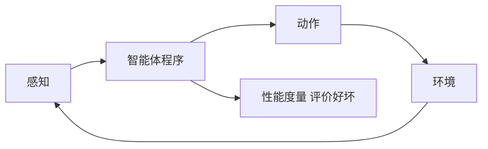

# 第 1 章：绪论

- **难度**：★☆☆ | **预估学时**：2 小时 | **前置**：无

## 学习目标
学完本章，你能：说出 AI 的四种研究取向及其分歧点；解释“理性智能体”方法为什么成为主流框架；复述 AI 的历史分期与两次寒冬的成因。

## 一句话核心
现代 AI 的标准定义不是“让机器像人一样思考”，而是“设计能根据环境信息做出合理行动的理性智能体”。

## 零基础讲解

### 概念 1：四种取向（难度：基础）
按“像人 / 理性”与“思考 / 行动”两个维度分成四格：像人思考（认知建模）、像人行动（图灵测试）、理性思考（逻辑主义）、理性行动（智能体）。

**为什么理性行动胜出**：它不要求复现人类的具体思维过程（那涉及神经科学），只要求行为在给定目标下足够好，因此可度量、可实现、可比较。

### 概念 2：智能体框架（难度：基础）
智能体 = 架构 + 程序。它通过传感器感知环境，通过执行器作用于环境。**性能度量**定义“什么算好”，**环境**定义“问题有多难”，**动作空间**定义“能做什么”。

**关键洞察**：AI 的全部技术都是在回答同一个问题——给定感知序列，如何选动作以最大化性能度量。后面 27 章都是这个问题的不同解法。

### 概念 3：历史与两次寒冬（难度：基础）
达特茅斯会议（1956）确立学科；早期靠符号推理与搜索；第一次寒冬源于“通用问题求解器”的过度承诺与算力不足；专家系统繁荣后又因知识获取瓶颈与维护成本进入第二次寒冬；随后统计学习与算力回升。

**读史的意义**：每一轮繁荣都伴随一种方法的过度泛化承诺，每一次寒冬都来自“承诺超出能力”。这个模式今天仍在重复。

## 与其他四本书的衔接
本章是全书索引。**《机器学习》** 对应第 19 章以下的学习分支；**《动手学深度学习》** 对应第 21、23、24、25 章；**《深度学习入门》** 是第 21 章的最小实现版；**《强化学习》** 对应第 22 章。本章不提供算法，只提供坐标。

## 图示

看图说明：这是一个闭环。所有 AI 技术都嵌在这个环的“程序”位置，区别只是程序内部用什么表示与什么推理方式。

## 常见误解
- 别以为 AI 的目标是复制人脑——实际上主流路径是“理性行动”，允许与人类完全不同的内部机制。
- 别以为寒冬说明 AI 没用——实际上每次寒冬都是“承诺 > 能力”，技术本身仍在积累。

## 自测题（答案）
1. 现代 AI 主流定义属于哪一格？（答案：D；解析：理性行动，即以智能体框架最大化性能度量。）
   - A. 像人思考　B. 像人行动　C. 理性思考　D. 理性行动
2. 两次寒冬的共同成因是？（答案：B；解析：过度承诺与能力不足的落差。）
   - A. 算力过剩　B. 承诺超出能力　C. 数据不足　D. 缺乏理论

## 复习锚点
- 四格取向：像人/理性 × 思考/行动。
- 智能体 = 架构 + 程序，感知—决策—行动闭环。
- 寒冬规律：承诺超过能力。
