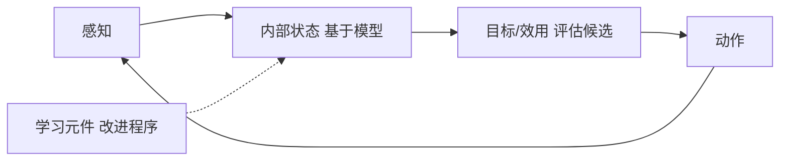

# 第 2 章：智能体

- **难度**：★★☆ | **预估学时**：3 小时 | **前置**：第 1 章

## 学习目标
学完本章，你能：用 PEAS 描述一个任务的性能度量、环境、执行器、传感器；按四种维度给环境分类；说出五种智能体结构各自适用什么环境。

## 一句话核心
选智能体结构前，先给环境画像：可观测性、确定性、动态性、离散性决定了哪种结构够用。

## 零基础讲解

### 概念 1：PEAS（难度：基础）
Performance（性能度量）、Environment（环境）、Actuators（执行器）、Sensors（传感器）。**做任何 AI 项目，第一件事就是把 PEAS 写出来**，否则后面所有设计都缺乏依据。

**实例**：自动驾驶出租车。性能=安全、时间、合法性、舒适、利润；环境=道路、其他车辆、行人、天气；执行器=方向盘、油门、刹车、喇叭、显示屏；传感器=摄像头、激光雷达、里程计、GPS。

### 概念 2：环境分类（难度：进阶）
- **完全可观测 / 部分可观测**：能否一次看到全部状态。
- **确定性 / 随机性**：同一动作结果是否唯一。
- **片段式 / 连续式**：子问题是否独立。
- **静态 / 动态**：环境在智能体思考时是否变化。
- **离散 / 连续**：状态与动作是否可枚举。
- **单智能体 / 多智能体**：是否有别的决策者。

**维度决定难度**：部分可观测 + 随机 + 动态 + 连续，是现实世界的常态，也是最难的组合。

### 概念 3：五种结构（难度：进阶）
1. **简单反射**：只看当前感知，查表出动作。只在完全可观测、确定性环境里可靠。
2. **基于模型的反射**：维护内部状态，记住看不到的部分。
3. **基于目标**：考虑目标，做规划。
4. **基于效用**：目标不够用时，用效用函数比较多个目标。
5. **学习型**：包含性能元件、 critic、学习元件、问题生成器，能改进自己。

**为什么需要学习元件**：环境未知或会变，靠预先编码不可能覆盖。

## 与其他四本书的衔接
**《强化学习》** 整本书就是在讲第五种结构里“学习元件”如何工作：策略=性能元件，价值函数=critic。**《机器学习》** 提供学习元件的各种实现。本章的“环境分类”直接决定后面用哪种方法：确定环境用搜索，随机环境用概率推理，未知环境用强化学习。

## 图示

看图说明：越往右结构越复杂，能应对的环境也越难。学习元件可以改造前面每一个环节。

## 常见误解
- 别以为越复杂的结构越好——实际上完全可观测、确定的环境里，简单反射就够，复杂结构反而增加出错点。
- 别以为“智能体”必须是实体机器人——实际上软件进程、游戏角色、推荐系统都符合定义。

## 自测题（答案）
1. PEAS 中的 E 指？（答案：B；解析：Environment，环境。）
   - A. 执行器　B. 环境　C. 评估　D. 经验
2. 部分可观测环境中最少需要哪种结构？（答案：C；解析：需要维护内部状态，即基于模型的反射智能体。）
   - A. 简单反射　B. 基于目标　C. 基于模型的反射　D. 学习型

## 复习锚点
- PEAS 四要素是一切 AI 项目的起点。
- 环境六个维度决定方法选择。
- 五种结构从简单反射到学习型逐级增强。
