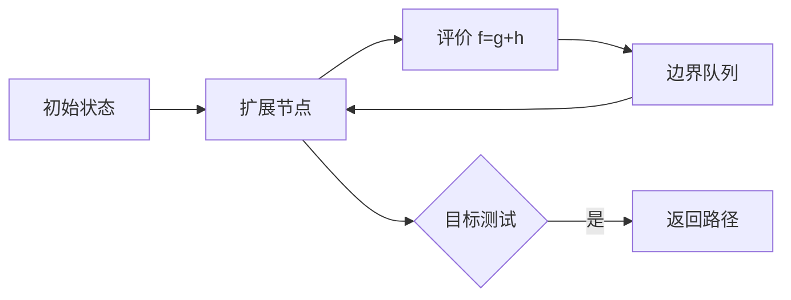

# 第 3 章：通过搜索进行问题求解

- **难度**：★★★ | **预估学时**：4 小时 | **前置**：第 2 章、图与树

## 学习目标
学完本章，你能：把一个实际问题形式化为状态空间搜索；比较宽度优先、深度优先、一致代价、A* 的完备性与最优性；说明启发函数的可采纳性条件；手算一个 A* 的搜索过程。

## 一句话核心
搜索把“怎么达到目标”变成“在状态图上找一个路径”，算法差异全在“先扩展哪个节点”。

## 零基础讲解

### 概念 1：问题形式化（难度：基础）
五要素：初始状态、动作、转移模型、目标测试、路径代价。

**实例（八数码）**：初始布局、空格移动、移动后的布局、是否达到目标布局、每步代价 1。状态数是 9!/2=181440 个可达状态——这说明穷举可行但需要好的顺序。

### 概念 2：四种无信息搜索（难度：进阶）
- **宽度优先 BFS**：按深度逐层扩展。完备、最优（代价相同时），空间 O(b^d)。
- **深度优先 DFS**：一路到底。空间省 O(bm)，但不完备（有环或无限深）、不最优。
- **一致代价 UCS**：每次扩展代价最小的节点。完备、最优，时间随代价增长。
- **深度受限 / 迭代加深**：限制深度；迭代加深反复加深，兼具 BFS 的最优与 DFS 的空间。

### 概念 3：A* 与启发式（难度：高难）
`f(n) = g(n) + h(n)`，g 是已花代价，h 是到目标的估计。**可采纳**：h 从不高估真实代价。**一致（consistent）**：h(n) ≤ c(n,n') + h(n')。

**结论**：h 可采纳 → A* 树搜索最优；h 一致 → A* 图搜索（不重复扩展）最优。**为什么**：可采纳保证不会因为高估而错过更优路径；一致保证第一次扩展到某节点时就是最优路径。

**实例（八数码）**：h1=错位棋子数（可采纳但松），h2=曼哈顿距离和（可采纳且更紧）。h2 扩展的节点数明显少于 h1。

## 与其他四本书的衔接
搜索是 AIMA 独有的一条线，四本配套书都不展开。但它的思想在别处出现：**《强化学习》** 第 8 章的规划与树搜索是同一逻辑在马尔可夫决策过程上的版本；**《机器学习》** 第 4 章的决策树构建也是一种贪心搜索。读本章要抓“状态空间 + 评价函数 + 扩展顺序”这个三元结构。

## 图示

看图说明：搜索的全部差异在于队列怎么排：先进先出是 BFS，后进先出是 DFS，按代价是 UCS，按 f 是 A*。

## 常见误解
- 别以为启发函数越大越好——实际上只有可采纳时才保证最优，高估会走错路。
- 别以为 A* 一定比 BFS 快——实际上 h≡0 时它退化成 UCS。
- 别以为搜索只适用于小问题——实际上配合好的启发式与剪枝，它能处理很大的状态空间。

## 自测题（答案）
1. A* 树搜索保证最优的条件是？（答案：B；解析：h 可采纳，即从不高估。）
   - A. h 一致　B. h 可采纳　C. h 单调　D. h 为 0
2. DFS 的主要缺陷是？（答案：C；解析：可能沿无限路径走下去，不完备也不最优。）
   - A. 空间太大　B. 时间太长　C. 不完备且不最优　D. 需要启发函数

## 复习锚点
- 搜索三要素：状态空间、评价函数、扩展顺序。
- BFS 最优但费空间，DFS 省空间但不完备。
- A*：f=g+h，h 可采纳保最优。
