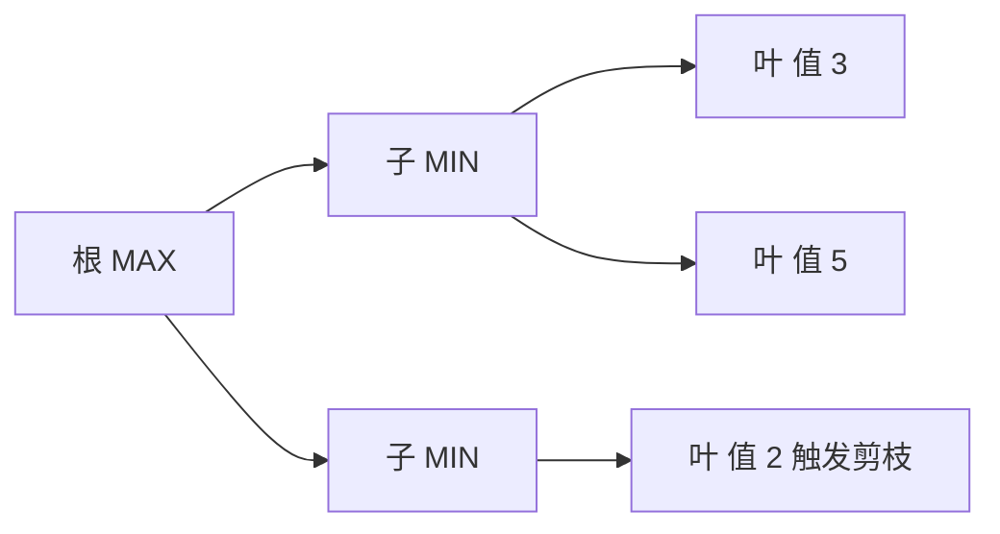

# 第 5 章：对抗搜索和博弈

- **难度**：★★★ | **预估学时**：4 小时 | **前置**：第 3、4 章

## 学习目标
学完本章，你能：画出极小化极大算法并说明它的假设；解释 α-β 剪枝为什么能剪掉而不影响结果；说明深度受限 + 评价函数带来的近似性质；说出蒙特卡洛树搜索的四个步骤。

## 一句话核心
博弈搜索在“对手一定选最坏应对”的假设下，找自己最稳妥的一步。

## 零基础讲解

### 概念 1：极小化极大（难度：进阶）
`Minimax(s) = max_a min_s' Minimax(s')`（轮到自己时取最大，轮到对手时取最小）。它假设双方完美、零和、确定性。

**为什么取 min**：因为对手会选择让你最不利的走法。这是“最坏情况最优”的策略。

### 概念 2：α-β 剪枝（难度：高难）
维护 α（当前 MAX 路径已知下界）与 β（MIN 路径已知上界）。当某节点的值超出区间 `[α,β]` 时，其后续兄弟节点可剪掉——因为父节点一定不会选它。

**性质**：剪枝不改变根节点值，只是少算；最优顺序下复杂度从 O(b^d) 降到 O(b^{d/2})，等于深度减半。

**实例**：根为 MAX，第一个子节点值 3（α=3）；第二个子节点是 MIN，展开第一个孙子得 2（β=2），此时 β<α 已经确定这个 MIN 节点最多 2，根不会选它，剩下孙子全剪。

### 概念 3：深度受限与评价（难度：进阶）
真实博弈树太深，只能搜到固定深度，用评价函数估计局面好坏。**这时最优性不再保证**：评价函数有偏、地平线效应（刚好在深度边界发生的大变化看不到）都会导致错判。

### 概念 4：MCTS（难度：高难）
四步：选择（按 UCB 选路径）、扩展（加一个节点）、模拟（随机走到底）、回传（更新访问次数与胜率）。它不需要评价函数，靠大量采样逼近，适合分支极宽的问题（围棋）。

## 与其他四本书的衔接
博弈里的“在最坏对手下最大化收益”与**《强化学习》** 第 18 章（多智能体）的博弈论视角直接相连；MCTS 在 Sutton 书第 8 章的树搜索一节也有对应。区别是：这里假设完全可观测与确定性，Sutton 书处理的是不确定环境。

## 图示

看图说明：一旦某个 MIN 节点的上界小于已知 MAX 下界，它的其余分支就不必再看。

## 常见误解
- 别以为 α-β 会改变搜索结果——实际上它只剪掉不影响根值的分支。
- 别以为评价函数越复杂越好——实际上它必须快，否则搜索深度上不去，效果反而差。
- 别以为 MCTS 不需要领域知识——实际上它常与策略网络结合来缩小搜索宽度。

## 自测题（答案）
1. α-β 剪枝对根节点值的影响是？（答案：A；解析：不改变结果，只减少计算。）
   - A. 不变　B. 变大　C. 变小　D. 不确定
2. 深度受限搜索失去的保证是？（答案：B；解析：用评价函数近似，最优性不再保证。）
   - A. 完备性　B. 最优性　C. 终止性　D. 正确性定义

## 复习锚点
- Minimax：自己取 max，对手取 min。
- α-β：不影响结果，最优顺序下复杂度开方。
- 深度受限用评价函数，最优性不再保证。
- MCTS 四步：选择、扩展、模拟、回传。
