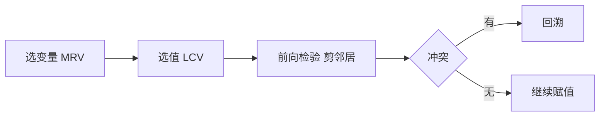

# 第 6 章：约束满足问题

- **难度**：★★★ | **预估学时**：3 小时 | **前置**：第 3 章

## 学习目标
学完本章，你能：把 CSP 形式化为变量、值域、约束；用前向检验与弧相容剪掉不可能取值；解释回溯搜索为什么比标准搜索高效；说出约束传播与变量排序的启发式。

## 一句话核心
CSP 把“找满足一组约束的赋值”从搜索问题中单独拎出来，用约束结构大幅剪枝。

## 零基础讲解

### 概念 1：形式化（难度：基础）
变量集合 X、值域 D、约束集合 C。**实例（地图着色）**：三个区域，三色可选，相邻不能同色。变量=区域，值域={红,绿,蓝}，约束=相邻不同色。

**与一般搜索的差别**：一般搜索只看“动作后果”，CSP 能利用“哪些取值一定不可能”这种全局信息。

### 概念 2：约束传播（难度：高难）
- **前向检验**：给某变量赋值后，删掉邻居值域中与新赋值冲突的取值。
- **弧相容（AC-3）**：对每条弧 (Xi,Xj)，若 Xi 的某个取值在 Xj 中找不到相容取值，就删掉它；反复直到稳定。

**代价**：传播本身要花时间，过强的传播可能得不偿失——这是 CSP 里的经典权衡。

### 概念 3：回溯与启发式（难度：进阶）
**回溯搜索**：按变量顺序赋值，冲突就回退。**变量排序（MRV）**：优先选剩余可选值最少的变量（最受约束优先）。**值排序（LCV）**：优先选给邻居留余地最大的值。

**实例**：数独。MRV 让程序先填那些只剩一个可能数字的格子，几乎不用回溯。

## 与其他四本书的衔接
CSP 在四本书中没有对应章节，但它是**《机器学习》** 第 15 章规则学习与第 14 章概率图模型中“约束/因子”思想的符号版本。理解 CSP 的传播机制，有助于理解贝叶斯网里的变量消去为什么能剪枝。

## 图示

看图说明：三个启发式分别解决“先动谁、先取什么、动完怎么剪”。

## 常见误解
- 别以为约束越多越难解——实际上约束越多，传播剪得越狠，有时反而更快。
- 别以为弧相容能替代搜索——实际上它只能剪掉不可能取值，不能保证找到解。

## 自测题（答案）
1. MRV 启发式选什么变量？（答案：B；解析：剩余可选值最少的，即最受约束的。）
   - A. 值域最大的　B. 剩余可选值最少的　C. 最先出现的　D. 约束最少的
2. 弧相容的作用是？（答案：A；解析：删掉在邻居中找不到相容取值的值，缩小搜索空间。）
   - A. 剪掉不可能取值　B. 直接求解　C. 排序变量　D. 生成新约束

## 复习锚点
- CSP 三要素：变量、值域、约束。
- 前向检验剪邻居，弧相容反复传播到稳定。
- MRV 选变量、LCV 选值。
