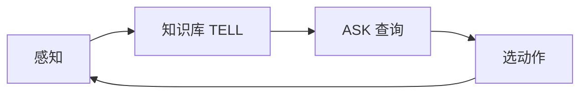

# 第 7 章：逻辑智能体

- **难度**：★★★ | **预估学时**：4 小时 | **前置**：第 2、3 章、命题逻辑

## 学习目标
学完本章，你能：写出命题逻辑的语法与语义；用真值表判断蕴含与等价；解释可靠性、完备性、蕴含的关系；说明归结法为什么完备。

## 一句话核心
逻辑智能体把“知道什么”写成命题，把“该做什么”转成“从知识库能推出什么”。

## 零基础讲解

### 概念 1：语法与语义（难度：基础）
语法是符号与连接词（¬ ∧ ∨ → ↔）的合法组合；语义是“在某个可能世界中是真是假”。**关键区分**：语法讲形式，语义讲真假，两者不能混。

**蕴含** `KB ⊨ α` 的意思是：所有让 KB 为真的世界，α 也为真。注意它不要求 KB 为真——前提为假时蕴含自动成立。

### 概念 2：推理规则（难度：进阶）
- **假言推理**：`A→B, A ⊢ B`。
- **与消解**：`A∧B ⊢ A`。
- **归结**：`(A∨B), (¬B∨C) ⊢ (A∨C)`。它把两句话里的互补文字消掉，得到新句子。

**归结为什么完备**：命题逻辑里，若 KB ⊨ α，则 KB∧¬α 不可满足；归结能推出空子句当且仅当不可满足（归结完备性定理）。所以“反证 + 归结”能推出所有蕴含。

### 概念 3：智能体的动作（难度：进阶）
给定感知，把感知加入 KB，然后对每个可能的动作 a，检查 `KB ⊨ 执行 a 后目标达成`。若都推不出，就选一个“不导致灾难”的动作（安全性检查）。

**这就是“逻辑智能体”的全部**：感知 → 更新 KB → 推理 → 选动作。它的局限是：只能处理确定、可完全表示的知识；现实中的不确定性它无法表达。

## 与其他四本书的衔接
逻辑方法在四本配套书里被“统计方法”替代——这是 AI 的一条根本分野。**《机器学习》** 第 7 章的贝叶斯分类器与第 14 章的概率图模型，处理的正是不确定性；**《强化学习》** 则完全放弃“先验知识库”，改用经验。读本章的价值是理解“为什么符号方法在开放环境里失效”。

## 图示

看图说明：TELL 与 ASK 是两个基本操作。所有推理都发生在 ASK 这一步。

## 常见误解
- 别以为“蕴含”要求前提为真——实际上前提假时蕴含恒真，这是最容易搞错的一点。
- 别以为归结只对简单公式有效——实际上它对整个命题逻辑完备。

## 自测题（答案）
1. `KB ⊨ α` 的含义是？（答案：C；解析：所有使 KB 为真的世界也使 α 为真。）
   - A. KB 为真　B. α 可证明　C. 所有 KB 为真的世界 α 也为真　D. KB 与 α 等价
2. 归结法完备性指的是？（答案：B；解析：若蕴含成立，反证 + 归结必能推出空子句。）
   - A. 一定能找到最短证明　B. 蕴含成立时必能推出空子句　C. 只能处理简单公式　D. 不需要前提

## 复习锚点
- 语法管形式，语义管真假。
- 蕴含：KB 为真的世界 α 也为真。
- 归结完备：反证能推出空子句即不可满足。
