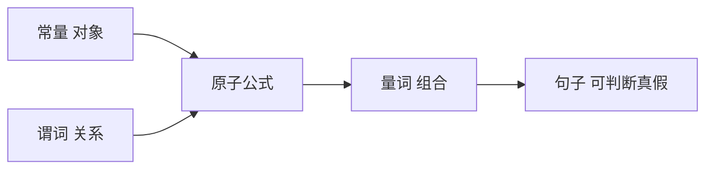

# 第 8 章：一阶逻辑

- **难度**：★★★ | **预估学时**：4 小时 | **前置**：第 7 章

## 学习目标
学完本章，你能：说出命题逻辑的局限与一阶逻辑的补充；写出量词 ∀、∃ 的语义与否定规则；用合一算法匹配两个含变量的表达式；说明一阶逻辑的表示力与不可判定性。

## 一句话核心
一阶逻辑引入对象、关系与量词，能表达“所有”“存在”，因此能描述命题逻辑描述不了的结构。

## 零基础讲解

### 概念 1：为什么需要一阶逻辑（难度：进阶）
命题逻辑只能表达“P 为真”，无法表达“所有学生都通过了”或“存在一个人”。它把每个具体事实写成一个独立命题，无法泛化。

**一阶逻辑三件套**：对象（常量）、关系（谓词）、函数。加上量词 `∀`（所有）与 `∃`（存在），就能写 `∀x 学生(x) → 通过(x)`。

### 概念 2：量词的语义（难度：进阶）
`∀x P(x)`：论域中每个对象都满足 P。
`∃x P(x)`：论域中至少一个对象满足 P。

**否定规则**（必须记住）：`¬∀x P(x) ≡ ∃x ¬P(x)`；`¬∃x P(x) ≡ ∀x ¬P(x)`。**量词的顺序不能交换**：`∀x ∃y 爱(x,y)`（每个人都有爱的人）与 `∃y ∀x 爱(x,y)`（存在一个人被所有人爱）意思完全不同。

### 概念 3：合一（难度：高难）
合一找一个替换，使两个表达式相同。例如 `Knows(John,x)` 与 `Knows(John,Jane)` 合一为 `{x/Jane}`。

**为什么需要**：归结时要先让两个子句的互补文字“对上”，合一就是找这个替换。**最一般合一（MGU）** 是最省约束的那个替换。

### 概念 4：表示力与代价（难度：高难）
一阶逻辑能表达算术、集合论的大部分内容。代价是**半可判定**：真命题一定能被证明，但假命题不保证能证明（会一直算下去）。这是它无法成为通用推理引擎的根本原因。

## 与其他四本书的衔接
**《机器学习》** 第 15 章归纳逻辑程序设计（ILP）直接用一阶逻辑表示规则，是本章的“学习版”。**AIMA 第 10、11 章**的知识表示与规划进一步用它。四本书里没有别的地方系统使用一阶逻辑，这也是符号 AI 与统计 AI 的分界线。

## 图示

看图说明：从对象到原子公式到量词组合，表示力逐级上升，判断复杂度也逐级上升。

## 常见误解
- 别以为 ∀ 和 ∃ 可以随便换序——实际上换序会彻底改变含义。
- 别以为一阶逻辑能判断所有命题的真假——实际上它半可判定，假命题可能永远算不出。

## 自测题（答案）
1. `¬∀x P(x)` 等价于？（答案：C；解析：否定全称量词得到存在否定。）
   - A. ∀x¬P(x)　B. ¬∃xP(x)　C. ∃x¬P(x)　D. ∃xP(x)
2. `∀x∃y 爱(x,y)` 的含义是？（答案：A；解析：每个人各自有爱的人。）
   - A. 每个人都有爱的人　B. 存在一个人被所有人爱　C. 所有人爱同一个人　D. 没有人相爱

## 复习锚点
- 一阶逻辑 = 对象 + 谓词 + 量词。
- 量词否定：¬∀→∃¬，¬∃→∀¬。
- 量词顺序改变含义。
- 半可判定：真能证，假未必能证。
