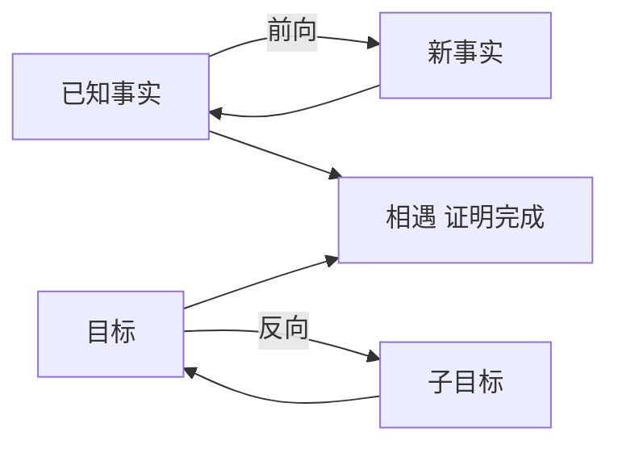

# 第 9 章：一阶逻辑中的推断

- **难度**：★★★ | **预估学时**：3 小时 | **前置**：第 8 章

## 学习目标
学完本章，你能：说出前向链接与反向链接的适用差别；写出归结反驳的步骤；解释 Horn 子句为什么高效；说明为什么完整的一阶推理不可行。

## 一句话核心
推断的方向决定了成本：从事实往前推会爆炸，从目标往回推只碰相关内容。

## 零基础讲解

### 概念 1：前向链接（难度：进阶）
从已知事实出发，反复应用规则推出新事实，直到目标出现。**数据驱动**，适合事实多、目标不明确的场景。缺点是会推出大量无关结论。

### 概念 2：反向链接（难度：进阶）
从目标出发，找能推出该目标的规则，把规则前提变成新的子目标。**目标驱动**，适合目标明确、事实多的场景。Prolog 就是反向链接。

### 概念 3：归结反驳（难度：高难）
要证 `KB ⊨ α`，就证 `KB ∧ ¬α` 不可满足：把 ¬α 加入知识库，反复归结，直到出现空子句。

**Horn 子句**（最多一个正文字）的特别之处：它的归结可以变成“前向/反向链接”，不需要完整的合一搜索，所以效率高得多。大部分现实规则库都是 Horn 形式。

### 概念 4：复杂度（难度：高难）
一般一阶推理是不可判定的（半可判定）。即便可判定，复杂度也可能极高。所以实际系统要么限制语言（Horn、描述逻辑），要么放弃完备性（用启发式）。

## 与其他四本书的衔接
本章的“目标驱动推理”与**《机器学习》** 第 15 章规则学习的“序贯覆盖”在结构上呼应：都是围绕目标逐步缩小搜索。区别是逻辑推理保证正确，规则学习只求统计上准。

## 图示

看图说明：前向从下往上堆，反向从上往下拆，两者在中间相遇即完成证明。

## 常见误解
- 别以为前向链接更“全面”就一定更好——实际上目标明确时它做了大量无用功。
- 别以为归结对任何逻辑都完备——实际上二阶及以上就不完备了。

## 自测题（答案）
1. Prolog 采用的推理方式是？（答案：B；解析：从目标反向链接。）
   - A. 前向链接　B. 反向链接　C. 真值表　D. 归结反驳
2. Horn 子句高效的原因是？（答案：C；解析：最多一个正文字，归结可退化为链接，避免完整合一搜索。）
   - A. 更短　B. 不需要变量　C. 归结可退化为链接　D. 一定可满足

## 复习锚点
- 前向数据驱动，反向目标驱动。
- 归结反驳：加入 ¬α 推空子句。
- Horn 子句把归结退化为链接，效率高。
- 一阶推理半可判定，实际系统常牺牲完备性。
