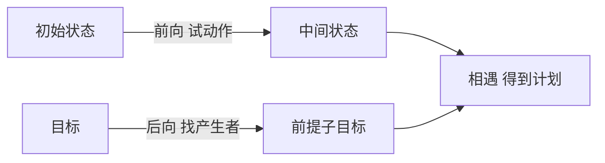

# 第 11 章：自动规划

- **难度**：★★★ | **预估学时**：4 小时 | **前置**：第 7、10 章

## 学习目标
学完本章，你能：写出 STRIPS 表示的动作三要素；说清前向搜索与后向搜索在规划中的差别；解释启发式规划为什么需要松弛问题；区分分层规划与机会主义规划。

## 一句话核心
规划 = 在“状态 + 动作前提与效果”的表示下，找一串动作把初始状态变成目标。

## 零基础讲解

### 概念 1：STRIPS 表示（难度：进阶）
每个动作三部分：**前提**（执行前必须为真的文字）、**删除列表**（执行后变假的）、**添加列表**（执行后变真的）。

**实例**：`Move(b,x,y)` 前提 `On(b,x) ∧ Clear(b) ∧ Clear(y)`；删除 `On(b,x), Clear(y)`；添加 `On(b,y), Clear(x)`。这套表示让“什么变了”非常清晰，便于推理。

### 概念 2：前向与后向（难度：进阶）
**前向**：从初始状态出发，试所有可执行动作。**后向**：从目标出发，找“哪个动作能产生该目标”，把前提变成新目标。

**为什么后向常更有效**：目标通常只涉及少量事实，后向搜索不会被大量无关动作淹没；但后向要处理“删除列表”带来的复杂条件（要保证动作不破坏已达成的目标）。

### 概念 3：启发式规划（难度：高难）
真实规划的搜索空间巨大，用**松弛问题**做启发：忽略删除列表（假设事实一旦为真就永远为真），此时子目标可以独立达成，问题变简单，其解的长度可当作原问题的下界估计。

**为什么能当下界**：松弛问题比原问题容易，它的最优代价不会超过原问题——所以是可采纳启发式。

### 概念 4：分层与机会主义（难度：进阶）
**分层规划**：把任务拆成抽象层与具体层，先在高抽象层规划，再细化。**机会主义**：执行中发现机会就调整，不必严格按预定顺序。

## 与其他四本书的衔接
规划在**《强化学习》** 里有对应物：Sutton 书第 8 章的 Dyna 与第 16 章的 AlphaGo 都是“用模型做前瞻”。区别是：规划假设确定性、离散动作、有明确目标；强化学习处理随机性与奖励。**《机器学习》** 第 4 章决策树的贪心分裂与规划的子目标分解也有结构相似性。

## 图示

看图说明：两个方向各自削减搜索空间，相遇即找到动作序列。

## 常见误解
- 别以为忽略删除列表的松弛一定错——实际上它不保证可行，但保证启发值不高估。
- 别以为后向搜索总是更好——实际上动作效果复杂时，后向条件更难处理。

## 自测题（答案）
1. STRIPS 动作的三要素是？（答案：B；解析：前提、删除列表、添加列表。）
   - A. 名称、参数、代价　B. 前提、删除、添加　C. 输入、输出、状态　D. 变量、约束、目标
2. 松弛规划忽略删除列表后得到的启发式？（答案：C；解析：松弛问题更易，其解代价是原问题下界，故可采纳。）
   - A. 不可采纳　B. 高估代价　C. 可采纳的下界　D. 精确值

## 复习锚点
- STRIPS：前提、删除、添加。
- 前向试动作，后向找产生者。
- 松弛忽略删除列表，得到可采纳下界。
