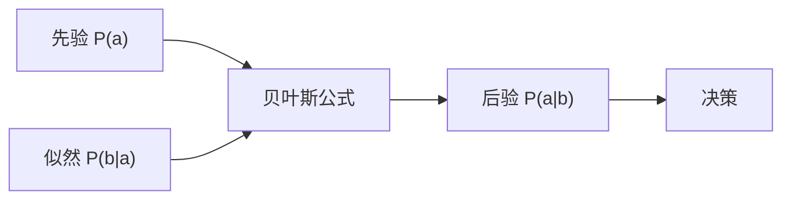

# 第 12 章：不确定性的量化

- **难度**：★★☆ | **预估学时**：3 小时 | **前置**：第 7 章、概率基础

## 学习目标
学完本章，你能：说明为什么需要概率而不是逻辑；写出条件概率与贝叶斯公式；区分先验与后验；解释条件独立为什么能大幅简化计算。

## 一句话核心
概率是“在不完全信息下做理性决策”的语言，它把“我不知道”量化成可计算的形式。

## 零基础讲解

### 概念 1：为什么放弃纯逻辑（难度：基础）
逻辑只能处理“真/假”，但现实中的知识是“大概率”“有可能”。强行二值化会导致规则冲突或需要无穷多例外。概率给出连续的置信度，且能在新证据下更新。

### 概念 2：条件概率与贝叶斯（难度：进阶）
`P(a|b) = P(a∧b)/P(b)`。贝叶斯公式 `P(a|b) = P(b|a)P(a)/P(b)`。

**先验与后验**：P(a) 是看到证据前的信念，P(a|b) 是看到证据后的信念。贝叶斯公式就是“如何用证据更新信念”的公式。

**实例**：疾病患病率 1%（先验），检测灵敏度 90%，假阳性率 5%。检测阳性时患病概率 = 0.9×0.01/(0.9×0.01 + 0.05×0.99) = 0.009/(0.009+0.0495) = 0.154。只有 15.4%——这就是“基础比率”效应。

### 概念 3：条件独立（难度：进阶）
`P(a∧b|c) = P(a|c)P(b|c)`。在给定 c 时，a 与 b 无关。

**为什么重要**：n 个变量的联合分布需要 2^n 个参数；若都条件独立于某变量，参数量降到线性。这是贝叶斯网能工作的基础。

## 与其他四本书的衔接
这一部分直接连到**《机器学习》** 第 7 章（贝叶斯分类器）与第 14 章（概率图模型）。**《深度学习入门》** 第 3 章的 softmax 输出也在这套语言下解释为概率。从本章起，AIMA 从“符号”转向“概率”，这是全书最重要的一次转向。

## 图示

看图说明：先验与似然合成后验，后验再进入决策。这是所有概率推理的共同骨架。

## 常见误解
- 别以为检测阳性就大概率有病——实际上基础比率低时后验仍很小。
- 别以为条件独立等于独立——实际上给定条件下独立不代表无条件独立。

## 自测题（答案）
1. 患病率 1%、灵敏度 90%、假阳性 5%，检测阳性时患病概率约为？（答案：B；解析：0.009/(0.009+0.0495)=15.4%。）
   - A. 90%　B. 15.4%　C. 50%　D. 1%
2. 条件独立的定义是？（答案：A；解析：P(a∧b|c)=P(a|c)P(b|c)。）
   - A. 给定 c 时联合等于边缘乘积　B. 无条件联合等于乘积　C. P(a)=P(b)　D. 互斥

## 复习锚点
- 贝叶斯公式：后验 ∝ 似然 × 先验。
- 基础比率会显著拉低后验。
- 条件独立把指数级参数降到线性。
