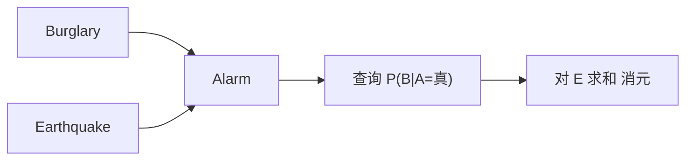

# 第 13 章：概率推理

- **难度**：★★★ | **预估学时**：4 小时 | **前置**：第 12 章

## 学习目标
学完本章，你能：写出贝叶斯网的分解公式；用枚举法算一个简单网络的查询；说明变量消去为什么比枚举快；解释近似推理适用的场景。

## 一句话核心
贝叶斯网把联合分布拆成局部条件概率的乘积，查询就变成“在因子上做乘加消元”。

## 零基础讲解

### 概念 1：网络结构与分解（难度：进阶）
每个节点给定父节点后的条件概率表。联合分布 `P(X1,...,Xn)=Π P(Xi|Parents(Xi))`。

**实例**： burglary → alarm ← earthquake。三个节点，联合 = P(B)P(E)P(A|B,E)，参数只有 1+1+4=6 个，而全联合要 8 个（且其中 2 个冗余）。

### 概念 2：精确推理（难度：高难）
**枚举法**：对未观测变量求和。`P(B|A) = Σ_E P(B)P(E)P(A|B,E) / P(A)`。复杂度随变量数指数增长。

**变量消去**：按顺序把变量逐个“乘进去再求和消掉”，中间的因子可以复用。它把重复计算消掉，复杂度取决于消元顺序（对应图的树宽）。

### 概念 3：近似推理（难度：高难）
- **似然加权**：按证据采样，非证据变量按先验采，证据变量固定，用权重修正。
- **MCMC / Gibbs**：按条件分布逐个变量重采样，长期频率逼近后验。
- **变分**：用一个简单分布逼近后验，把推理变成优化。

## 与其他四本书的衔接
本章是**《机器学习》** 第 14 章概率图模型的前半部分（有向图与推断），第 20 章“概率模型学习”则是它的参数学习版。**《深度学习入门》** 与**《动手学深度学习》** 里的生成模型（VAE、GAN）可以看作“用神经网络参数化概率分布”的路线。

## 图示

看图说明：箭头是条件依赖方向，查询时把未观测的父节点消掉。消元顺序决定计算量。

## 常见误解
- 别以为贝叶斯网的箭头表示因果——实际上它只表示条件依赖，因果需要额外假设。
- 别以为枚举法准确就一定该用——实际上变量稍多就算不动。

## 自测题（答案）
1. 贝叶斯网联合分布的分解依据是？（答案：B；解析：每个节点给定父节点的条件概率相乘。）
   - A. 全概率公式　B. 局部条件概率相乘　C. 贝叶斯公式　D. 独立性假设
2. 变量消去比枚举快的原因是？（答案：C；解析：中间因子可复用，避免重复计算。）
   - A. 用了近似　B. 变量更少　C. 消元顺序复用中间结果　D. 不需要证据

## 复习锚点
- 贝叶斯网：Π P(Xi|Parents)。
- 枚举法准确但指数复杂度。
- 变量消去复用因子，复杂度看树宽。
- 大规模用采样或变分。
