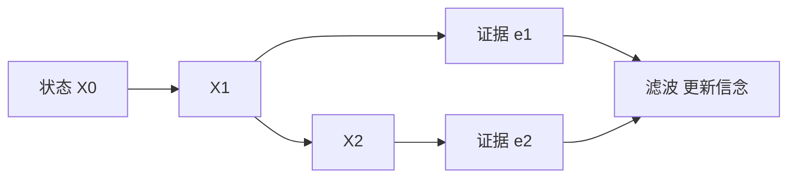

# 第 14 章：时间上的概率推理

- **难度**：★★★ | **预估学时**：3 小时 | **前置**：第 13 章

## 学习目标
学完本章，你能：写出马尔可夫假设的含义；区分滤波、预测、平滑、最可能解释四个任务；说明卡尔曼滤波与隐马尔可夫模型各自的假设；解释粒子滤波为什么适合非线性场景。

## 一句话核心
时间上的推理就是把“状态随时间演化”写成马尔可夫链，再按证据不断修正对当前状态的信念。

## 零基础讲解

### 概念 1：四个任务（难度：进阶）
- **滤波**：给定至今的证据，算当前状态的后验 `P(X_t|e_{1:t})`。
- **预测**：算未来状态 `P(X_{t+k}|e_{1:t})`。
- **平滑**：给定全部证据，算过去某时刻状态 `P(X_k|e_{1:t})`。
- **最可能解释**：找最可能的整条状态序列。

**为什么滤波是核心**：智能体要在当下行动，只需要当前状态的后验。

### 概念 2：递归滤波（难度：高难）
两步：**预测** `P(X_{t+1}|e_{1:t}) = Σ_{x_t} P(X_{t+1}|x_t)P(x_t|e_{1:t})`；**更新** `P(X_{t+1}|e_{1:t+1}) ∝ P(e_{t+1}|X_{t+1})P(X_{t+1}|e_{1:t})`。

**这正好是贝尔曼方程的贝叶斯版**：用转移模型往前推，用观测模型校正。

### 概念 3：HMM 与卡尔曼滤波（难度：高难）
- **HMM**：状态离散、转移与观测都是表格。推理用前向—后向算法。
- **卡尔曼滤波**：状态连续、转移与观测都是线性高斯。此时后验也是高斯，只需更新均值与协方差，有闭式解。

**为什么卡尔曼这么重要**：线性高斯假设让“无限维的信念分布”压缩成有限个参数，工程上极其高效。

### 概念 4：粒子滤波（难度：高难）
用一组加权样本表示后验：按转移模型传播粒子，按观测似然重新加权，重采样避免退化。**优点**：不要求线性高斯，适用非线性非高斯场景。**缺点**：高维时粒子数爆炸。

## 与其他四本书的衔接
**《动手学深度学习》** 第 6 章的 RNN 是本章的“用神经网络做滤波”：隐状态就是信念的压缩表示。**《强化学习》** 第 3 章的部分可观测 MDP（POMDP）直接用本章的信念状态做决策。**《机器学习》** 第 14 章的 HMM 是本章的经典实例。

## 图示

看图说明：横向是状态演化，向下是观测。滤波把左边传来的先验与向下的似然合成后验。

## 常见误解
- 别以为平滑和滤波是一回事——实际上平滑要用未来证据，只用于离线分析。
- 别以为卡尔曼滤波只能处理线性——实际上有扩展卡尔曼与无迹卡尔曼处理非线性，只是近似。

## 自测题（答案）
1. 滤波算的是？（答案：B；解析：给定至今的证据，当前状态的后验。）
   - A. 未来状态　B. 当前状态后验　C. 过去状态　D. 整条序列
2. 卡尔曼滤波的闭式解依赖什么假设？（答案：C；解析：线性转移与高斯噪声，使后验仍是高斯。）
   - A. 状态离散　B. 观测连续　C. 线性高斯　D. 马尔可夫性

## 复习锚点
- 四任务：滤波、预测、平滑、最可能解释。
- 滤波两步：预测（转移）与更新（观测）。
- HMM 离散表格，卡尔曼线性高斯。
- 粒子滤波适合非线性非高斯。
