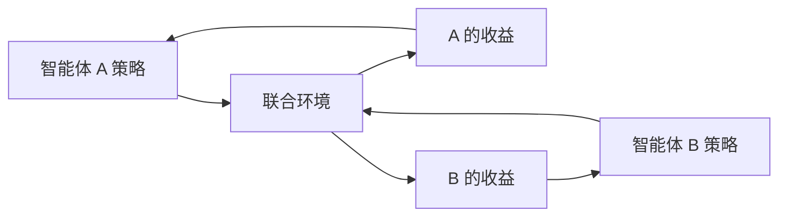

# 第 18 章：多智能体决策

- **难度**：★★★ | **预估学时**：3 小时 | **前置**：第 17 章、博弈论基础

## 学习目标
学完本章，你能：区分零和与非零和博弈的求解目标；说明纳什均衡的定义与局限；解释为什么多智能体环境下“最优”没有唯一含义；说出机制设计的基本目标。

## 一句话核心
有多个决策者时，“最优”不再是对一个人的最优，而是对一组人达成的稳定协议。

## 零基础讲解

### 概念 1：博弈的形式（难度：进阶）
参与者、策略集、收益函数。零和博弈中一方所得即另一方所失，可用极小化极大求解；非零和博弈可能有合作，也可能有冲突。

**实例（囚徒困境）**：双方都招供各判 3 年，都不招各判 1 年，一方招一方不招则招者 0 年、不招者 5 年。单方最优是招供，但双方都招的结果比都不招差——这是“个体理性导致集体非理性”。

### 概念 2：纳什均衡（难度：高难）
没有任何参与者能单方改变策略而获益的策略组合。**局限**：可能不存在（纯策略下）、可能多个、也不保证是社会最优（囚徒困境的均衡就是次优结果）。

### 概念 3：机制设计（难度：高难）
设计规则使自利的参与者行为导致好的集体结果。**关键概念：防策略性**——参与者没有动机谎报信息（如拍卖中的次价密封拍卖）。

## 与其他四本书的衔接
**《强化学习》** 第 18 章讲多智能体强化学习：多个学习者在同一环境里互相影响，彼此的“环境”都在变，因此收敛性远不如单智能体。本章提供博弈论语言，Sutton 书提供学习方法。

## 图示

看图说明：两个学习回路耦合在一起。A 改变策略就改变了 B 面对的环境，反之亦然。

## 常见误解
- 别以为纳什均衡就是最优结果——实际上它只是“没人想单方改变”。
- 别以为多智能体 RL 只是并行训练——实际上非平稳性会让单智能体的收敛证明全部失效。

## 自测题（答案）
1. 囚徒困境说明的核心现象是？（答案：B；解析：个体理性导致集体次优。）
   - A. 合作总是最优　B. 个体理性导致集体次优　C. 均衡唯一　D. 零和
2. 机制设计的关键要求是？（答案：C；解析：规则使参与者没有动机谎报。）
   - A. 收益最大　B. 计算最快　C. 防策略性　D. 均衡唯一

## 复习锚点
- 零和用极小化极大，非零和要谈均衡。
- 纳什均衡：无人能单方获益，不保证社会最优。
- 机制设计靠防策略性引导真实报告。
