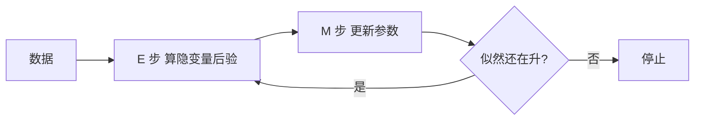

# 第 20 章：概率模型学习

- **难度**：★★★ | **预估学时**：4 小时 | **前置**：第 13、19 章

## 学习目标
学完本章，你能：写出最大似然估计与最大后验的区别；说明朴素贝叶斯为什么“朴素”；解释 EM 算法的两步在做什么；说出隐变量模型为什么需要 EM。

## 一句话核心
概率模型学习是在给定数据下估参数：频率派求最大似然，贝叶斯派求后验，有隐变量时用 EM 迭代。

## 零基础讲解

### 概念 1：最大似然与 MAP（难度：进阶）
MLE：`θ* = argmax Π P(x_i|θ)`，即最大化数据出现的概率。MAP：`argmax P(θ|数据) ∝ P(数据|θ)P(θ)`，多了先验。

**差别**：数据少时 MAP 更稳（先验起正则作用）；数据多时两者趋同。

### 概念 2：朴素贝叶斯（难度：进阶）
假设特征在给定类别下条件独立：`P(x|c) = Π P(x_i|c)`。“朴素”就是指这个（通常不成立的）假设。

**为什么还能用**：分类只关心哪类概率最大，不需要概率精确；独立性假设错但排序常仍对。

### 概念 3：EM 算法（难度：高难）
有隐变量 z 时，似然求和难解。EM 交替：
- **E 步**：用当前参数算隐变量的后验 `Q(z)`。
- **M 步**：用 Q 加权最大化期望对数似然，更新参数。

**为什么收敛**：每次迭代都不降低观测数据的对数似然（下界单调上升）。但它只保证到局部最优。

## 与其他四本书的衔接
**《机器学习》** 第 7 章（贝叶斯分类器）、第 14 章（EM 与 HMM 训练）是本章展开。**《动手学深度学习》** 里的 VAE 训练用的也是“下界最大化”，本质是变分版的 EM。

## 图示

看图说明：E 与 M 反复拉升同一个下界，直到不再改进。

## 常见误解
- 别以为朴素贝叶斯假设成立才好用——实际上假设不成立时它仍常有效。
- 别以为 EM 一定找到全局最优——实际上它只保证局部收敛，初值很关键。

## 自测题（答案）
1. 朴素贝叶斯的“朴素”指？（答案：B；解析：假设特征在给定类别下条件独立。）
   - A. 模型简单　B. 特征条件独立假设　C. 只用朴素特征　D. 不用概率
2. EM 的 E 步做什么？（答案：A；解析：用当前参数算隐变量后验。）
   - A. 算隐变量后验　B. 更新参数　C. 计算梯度　D. 选模型

## 复习锚点
- MLE 最大化数据概率，MAP 加先验。
- 朴素 = 特征条件独立。
- EM：E 算后验，M 更新参数，似然单调升。
