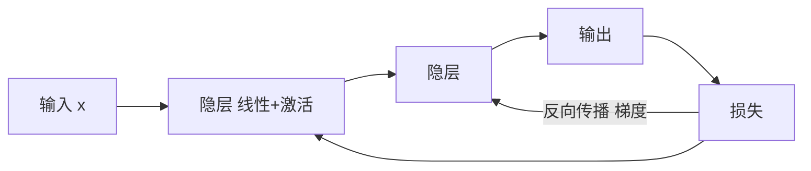

# 第 21 章：深度学习

- **难度**：★★★ | **预估学时**：6 小时 | **前置**：第 19、20 章、微积分与线代

## 学习目标
学完本章，你能：说明神经网络为什么需要非线性激活；写出反向传播的链式法则形式；解释卷积与池化各自的作用；说出注意力机制解决了什么问题。

## 一句话核心
深度学习 = 用多层可微函数堆出表示，用反向传播把梯度回传，用大量数据拟合。

## 零基础讲解

### 概念 1：从线性到非线性（难度：进阶）
单层线性网络无论多深都等价于一层线性变换。加入 ReLU 或 sigmoid 后，网络才能逼近非线性函数（万能逼近定理）。

**为什么 ReLU 常用**：导数在正区间恒为 1，缓解梯度消失，计算便宜。

### 概念 2：反向传播（难度：高难）
对每层算 `∂L/∂w = ∂L/∂y · ∂y/∂w`，从输出往输入逐层乘。**本质是链式法则 + 复用中间结果**：前向时存下激活值，反向时直接用，避免重复计算。

**实例**：`y = (wx+b)`，`L = y²`。`∂L/∂w = 2y · x`。若 w=2、x=3、b=1，则 y=7，∂L/∂w = 14×3 = 42。

### 概念 3：卷积与池化（难度：进阶）
**卷积**：用共享的小卷积核在空间上滑动，捕捉局部模式并大幅减少参数。**池化**：下采样，扩大感受野、提供一定平移不变性。

### 概念 4：注意力（难度：高难）
`Attention(Q,K,V) = softmax(QKᵀ/√d_k)V`。它让每个位置直接看到所有位置，避免了 RNN 的逐步传递。**缩放 √d_k 的原因**：点积方差随维度增长，不缩放会使 softmax 饱和、梯度消失。

## 与其他四本书的衔接
这一章是**《深度学习入门》** 全书的对应点（该书第 3—7 章逐层实现），也是**《动手学深度学习》** 第 3—6、9—10 章的主线。**《机器学习》** 第 5 章是它的浅层版（单隐层 BP 网络）。学这一章的正确顺序是：先读《深度学习入门》把反向传播手推一遍，再读 d2l 学框架实现，最后回来看本章的体系位置。

## 图示

看图说明：前向算值，反向算梯度。反向时每一层只需要局部导数与上游梯度相乘。

## 常见误解
- 别以为层数越多越好——实际上过深会梯度消失/爆炸，需要残差连接与归一化。
- 别以为反向传播是“另一种学习算法”——实际上它只是算梯度的方法，学习规则仍是梯度下降。
- 别以为注意力只是“加权求和”——实际上它让模型动态决定看哪里，参数随输入变化。

## 自测题（答案）
1. 没有非线性激活的多层网络等价于？（答案：A；解析：线性变换的复合仍是线性变换。）
   - A. 单层线性模型　B. 深层网络　C. 卷积网络　D. 决策树
2. 注意力中缩放 √d_k 的原因是？（答案：C；解析：点积方差随维度增大，不缩放会使 softmax 饱和。）
   - A. 加快计算　B. 减少参数　C. 控制点积方差避免 softmax 饱和　D. 增加表达力

## 复习锚点
- 非线性是深度的必要条件。
- 反向传播 = 链式法则 + 复用前向中间值。
- 卷积共享参数，池化扩大感受野。
- 注意力缩放 √d_k 防 softmax 饱和。
