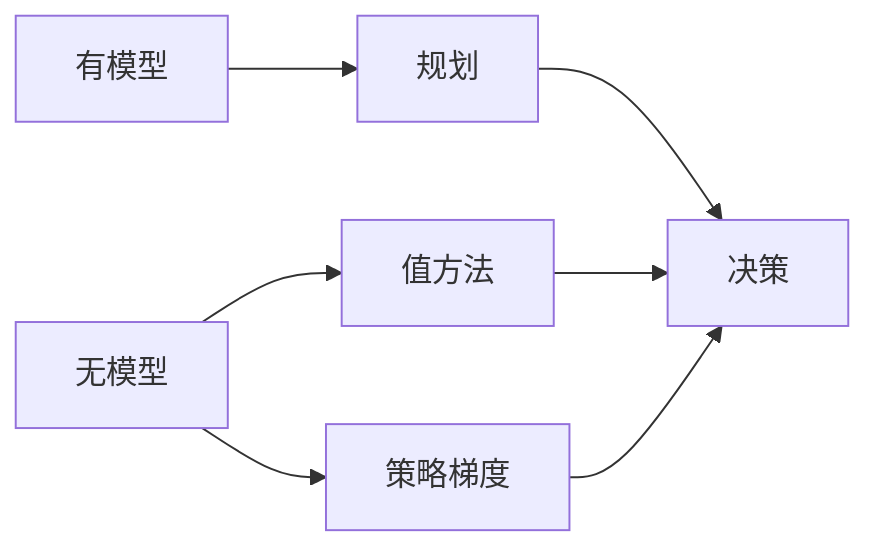

# 第 22 章：强化学习

- **难度**：★★★ | **预估学时**：4 小时 | **前置**：第 17 章

## 学习目标
学完本章，你能：写出 MDP 的价值函数与贝尔曼方程；区分基于模型与无模型方法；说明探索与利用的权衡；说出函数逼近带来的稳定性问题。

## 一句话核心
强化学习在不知道自己动作后果的情况下，通过试错与延迟奖励学会做决策。

## 零基础讲解

### 概念 1：与监督学习的差别（难度：基础）
没有即时标签，只有延迟奖励；数据由自己的策略产生；必须探索。这三点决定了它不能用普通监督学习的方法。

### 概念 2：价值与贝尔曼（难度：进阶）
`v_π(s) = Σ_a π(a|s) Σ_{s',r} p[r + γv_π(s')]`。这个递归把长期回报变成“一步 + 下一状态价值”，是所有方法的基石。

### 概念 3：三条技术路线（难度：进阶）
- **基于模型**：学环境模型再做规划（Dyna）。
- **无模型值方法**：直接学 q（Sarsa、Q-learning）。
- **策略梯度**：直接优化策略参数（REINFORCE、actor-critic）。

### 概念 4：不稳定（难度：高难）
函数逼近 + 自举 + 离轨三要素同时存在会发散。工程上用目标网络、经验回放、小步长缓解。

## 与其他四本书的衔接
本章是**《强化学习》** 全书的浓缩索引：第 3 章 MDP、第 4 章 DP、第 5—7 章 MC/TD/n 步、第 8 章规划、第 9—13 章函数逼近与策略梯度。**《机器学习》** 第 16 章是最简版。读 AIMA 这一章的作用是知道“RL 在 AI 体系中的位置”，读 Sutton 书是把它做实。

## 图示

看图说明：三条路线在“决策”处汇合，区别在于用什么中间量（模型、价值、策略）。

## 常见误解
- 别以为 RL 只用于游戏——实际上推荐、调度、控制都在用。
- 别以为奖励可以随便设——实际上奖励设计直接决定学到什么行为。

## 自测题（答案）
1. 贝尔曼方程把价值写成？（答案：B；解析：即时奖励加下一状态价值的折扣期望。）
   - A. 全部奖励之和　B. 一步奖励加后继价值折扣　C. 平均奖励　D. 最大奖励
2. 三要素中哪一组会导致发散？（答案：C；解析：函数逼近、自举、离轨。）
   - A. 探索、奖励、策略　B. 状态、动作、折扣　C. 逼近、自举、离轨　D. 采样、规划、学习

## 复习锚点
- RL 三特征：延迟奖励、数据自产、必须探索。
- 贝尔曼方程是所有方法的基石。
- 三条路线：模型、值、策略梯度。
- 三要素同时出现易发散。
