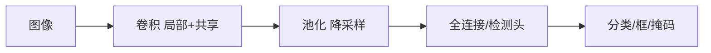

# 第 25 章：计算机视觉

- **难度**：★★★ | **预估学时**：3 小时 | **前置**：第 21 章

## 学习目标
学完本章，你能：说出图像形成的几何与光度要素；区分分类、检测、分割三类任务；解释卷积网络为什么适合图像；说明数据增广与预训练的作用。

## 一句话核心
视觉任务都是“从像素里抽结构”，卷积是把“局部性 + 平移不变”这两个先验写进网络结构的方式。

## 零基础讲解

### 概念 1：图像形成（难度：基础）
光照、表面反射、相机投影共同决定像素值。**理解这一点才知道为什么增广（翻转、裁剪、调色）合理**：这些变换近似对应真实世界的变化。

### 概念 2：三类任务（难度：进阶）
- **分类**：整张图一个标签。
- **检测**：框出每个物体的位置与类别。
- **分割**：逐像素给类别（语义分割）或给实例（实例分割）。

### 概念 3：卷积的归纳偏置（难度：进阶）
局部连接：像素只与邻域相关。参数共享：同一模式出现在不同位置应被同样识别。这两条先验大幅降低参数量，也带来平移等变性。

### 概念 4：数据与预训练（难度：进阶）
图像标注贵，所以常用大规模预训练 + 小数据微调。数据增广（随机裁剪、翻转、颜色抖动）相当于扩充数据分布，抑制过拟合。

## 与其他四本书的衔接
**《动手学深度学习》** 第 9 章是本章的实现版。**《深度学习入门》** 第 7 章用 NumPy 手写 CNN，适合先把卷积运算搞清。**《机器学习》** 只覆盖传统特征（SIFT、HOG），可作为历史对照。

## 图示

看图说明：卷积负责抽局部特征，池化负责扩大感受野，任务头负责输出不同形式。

## 常见误解
- 别以为 CNN 天然理解旋转——实际上普通卷积只对平移近似不变，旋转需要数据增广或特殊结构。
- 别以为分割只是分类的像素版——实际上它需要保留空间分辨率，结构上要用上采样与跳连。

## 自测题（答案）
1. 卷积的两个核心先验是？（答案：B；解析：局部连接与参数共享。）
   - A. 深度与宽度　B. 局部连接与参数共享　C. 归一化与残差　D. 注意力与门控
2. 语义分割与实例分割的差别是？（答案：C；解析：前者只分到类别，后者区分同类不同个体。）
   - A. 输入不同　B. 输出尺寸不同　C. 是否区分同类不同实例　D. 是否需要标签

## 复习锚点
- 卷积把局部性与平移不变写进结构。
- 分类/检测/分割输出形式不同。
- 预训练 + 增广是对抗标注稀缺的主要手段。
