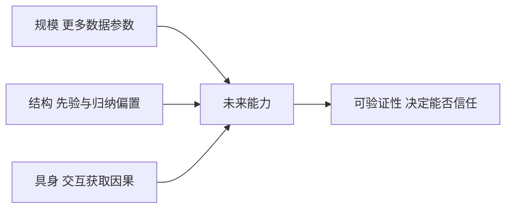

# 第 28 章：人工智能的未来

- **难度**：★★☆ | **预估学时**：2 小时 | **前置**：全书

## 学习目标
学完本章，你能：说出当前 AI 的三条主要发展路线及其依据；区分“能力增长”与“理解增长”；给出判断某项 AI 宣传是否可信的三条检查标准。

## 一句话核心
AI 的未来取决于三件事的进展：能否把常识与因果纳入模型、能否在开放环境中持续学习、能否让系统行为可验证。

## 零基础讲解

### 概念 1：三条路线（难度：进阶）
1. **规模路线**：更大模型 + 更多数据，相信能力会随规模涌现。
2. **结构路线**：把先验（因果、物理、逻辑）写进架构，相信数据效率更重要。
3. **具身路线**：让智能体在物理世界交互，用行动获取因果知识。

**三者的分歧在“智能从哪来”**：从数据规模、从结构归纳偏置、从交互经验。

### 概念 2：能力与理解（难度：进阶）
模型能在测试集上答对，不代表掌握了机制。**判断标准**：能否在分布外泛化、能否给出可检验的解释、能否被反例纠正。

### 概念 3：三条检查标准（难度：进阶）
看任何 AI 宣称时问：训练与测试分布是否相同？基线是否公平？失败案例是否公开？这三点能过滤掉大部分夸大宣传。

## 与其他四本书的衔接
本章是整套知识库的终点。**《机器学习》** 给的是“如何评估与选择模型”，**《深度学习入门》《动手学深度学习》** 给的是“如何实现”，**《强化学习》** 给的是“如何在交互中学习”，**AIMA** 给的是“这一切在 AI 版图上的位置”。读完这本骨架书再回看其余四本，会发现它们各自对应某一层的展开。

## 图示

看图说明：三条路线并行推进，但是否可信取决于最右边的可验证性。

## 常见误解
- 别以为规模能自动解决一切——实际上数据效率、因果推理仍是短板。
- 别以为基准分数高就代表可用——实际上分布外表现常大幅下降。

## 自测题（答案）
1. 判断 AI 宣称可信的三条标准不包括？（答案：C；解析：参数多少不等于能力。）
   - A. 训练测试分布是否一致　B. 基线是否公平　C. 参数量是否最大　D. 失败案例是否公开

## 复习锚点
- 三条路线：规模、结构、具身。
- 能力 ≠ 理解，看分布外与可纠正性。
- 三条检查标准：分布一致性、公平基线、公开失败。
