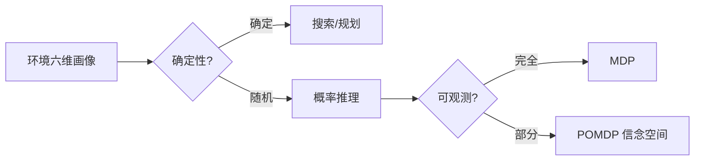

# 智能体的环境画像

- **难度**：进阶 | **涉及章节**：第 2、22 章

## 一句话定义
环境画像就是给任务打六个标签：可观测性、确定性、片段性、动态性、离散性、智能体数量。标签决定该用哪套方法。

## 为什么重要
这是整套知识库的“方法选择器”。同一句“做出好决策”，在完全可观测的确定环境里是搜索问题，在部分可观测的随机环境里是 POMDP 或强化学习问题。选错方法，后面所有工程都白做。

## 图示

## 详解
六个维度里，最影响方法选择的是“确定性”和“可观测性”。确定性决定能否用搜索（因果链唯一），可观测性决定决策对象是状态还是信念。

离散性影响表示方式（表格 vs 函数逼近），动态性影响是否需要实时响应，智能体数量影响是否需要博弈论。

## 常见误解
**别以为环境分类是理论分类**——实际上它直接对应算法选择。把一个随机环境当成确定环境去搜索，效果会明显变差。

## 在书中出现的脉络
| 章节 | 语境 | 关键结论 |
|---|---|---|
| 第 2 章 | 智能体结构 | 结构复杂度应与环境难度匹配 |
| 第 17 章 | 复杂决策 | 部分可观测导致信念空间 |
| 第 22 章 | 强化学习 | 未知环境用试错学习 |

## 相关概念
- 前置：PEAS
- 后续：MDP、POMDP、搜索
