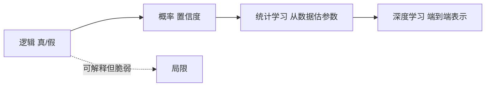

# 从符号到统计的转向

- **难度**：进阶 | **涉及章节**：第 7、12、21 章

## 一句话定义
AIMA 的第 7—11 章用逻辑表示知识，第 12 章起改用概率，第 19 章起改用学习。这条主线是“如何在不完全信息下处理知识”的一次范式转换。

## 为什么重要
理解这条转向，就理解了为什么今天的主流是“从数据学分布”，而不是“手工写规则”。这不是风格偏好，而是表示力与鲁棒性的权衡结果。

## 图示

## 详解
逻辑的优点是结论确定、可解释；缺点是要求知识完备且无冲突，现实做不到。概率允许“部分相信”，能在证据不足时给出合理答案。学习则进一步放弃“人工给知识”，改为从数据估参数。

代价是：统计方法通常不可解释、需要大量数据、难以保证边界行为。符号方法与统计方法在今天仍然并存（如神经符号系统）。

## 常见误解
**别以为转向意味着逻辑被淘汰**——实际上在需要严格保证的场景（验证、合同、硬件设计）逻辑仍是首选。

## 在书中出现的脉络
| 章节 | 语境 | 关键结论 |
|---|---|---|
| 第 7 章 | 命题逻辑 | 只能处理确定知识 |
| 第 12 章 | 不确定性量化 | 引入概率语言 |
| 第 19 章 | 样例学习 | 从数据而非规则获取知识 |
| 第 21 章 | 深度学习 | 表示本身也由数据学 |

## 相关概念
- 前置：蕴含、贝叶斯公式
- 后续：概率图模型、神经网络
