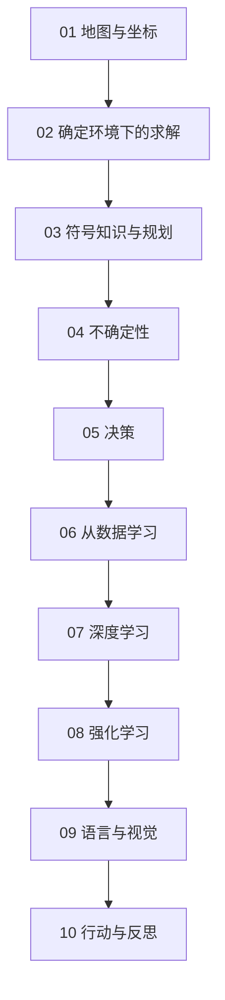

# 学习路径：人工智能：现代方法（第 4 版）

## 路径总览

## 逐步展开

### 步骤 01：地图与坐标
**阅读**：ch01, ch02
**检查点**：用 PEAS 描述一个你熟悉的 AI 产品
**目标**：建立全书坐标与智能体框架

### 步骤 02：确定环境下的求解
**阅读**：ch03, ch04, ch05, ch06
**检查点**：手跑一次 A*，手算一次 α-β 剪枝
**目标**：掌握搜索、博弈与约束求解

### 步骤 03：符号知识与规划
**阅读**：ch07, ch08, ch09, ch10, ch11
**检查点**：用归结证明一个简单蕴含
**目标**：理解逻辑方法与它的边界

### 步骤 04：不确定性
**阅读**：ch12, ch13, ch14, ch15
**检查点**：手算一次贝叶斯后验与一次滤波更新
**目标**：掌握概率表示与推断

### 步骤 05：决策
**阅读**：ch16, ch17, ch18
**检查点**：算一次信息价值，解释 POMDP 为何用信念
**目标**：掌握从信念到动作的转换

### 步骤 06：从数据学习
**阅读**：ch19, ch20
**检查点**：手算一次信息增益与一次 EM 迭代
**目标**：掌握学习的基本范式

### 步骤 07：深度学习
**阅读**：ch21
**检查点**：手推两层网络的反向传播
**目标**：掌握表示学习

### 步骤 08：强化学习
**阅读**：ch22
**检查点**：写出贝尔曼方程并说明三要素风险
**目标**：掌握交互学习

### 步骤 09：语言与视觉
**阅读**：ch23, ch24, ch25
**检查点**：说明自注意力为何优于 RNN
**目标**：掌握感知与语言的主流架构

### 步骤 10：行动与反思
**阅读**：ch26, ch27, ch28
**检查点**：说出对齐问题的技术版本
**目标**：把 AI 放回物理与社会语境

## 学完全程后

