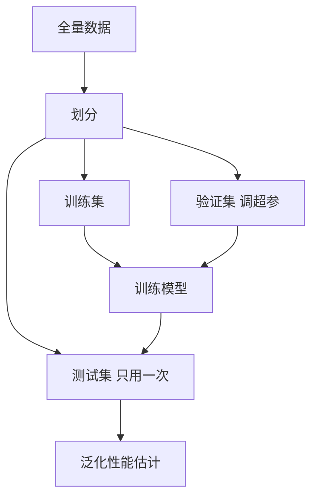

# 第 2 章：模型评估与选择

- **难度**：★★☆ | **预估学时**：4 小时 | **前置**：第 1 章、概率与统计基础

## 学习目标
学完本章，你能：说清留出法、交叉验证、自助法三种划分的适用场景；从混淆矩阵算出查准率、查全率与 F1；解释 ROC 曲线与 AUC 的含义；说明为什么“A 算法比 B 好 1%”这句话需要做显著性检验才算数。

## 一句话核心
评估不是“算个准确率”，而是设计一套能区分“真本事”和“运气”的流程。

## 零基础讲解

### 概念 1：三种划分（难度：基础）
- **留出法**：把数据按 7:3 或 8:2 切成训练/测试。缺点是切一次结果波动大，所以要多次随机切分取平均。
- **k 折交叉验证**：把数据分成 k 份，每次拿一份当测试、其余训练，做 k 次取平均。k 常取 5 或 10。数据少时用**留一法**（k=样本数），最准但计算量最大。
- **自助法**：有放回采样 m 次得到训练集，约 36.8% 的样本从未被抽到，拿来做测试集。适合数据集很小的情况，但会改变数据分布。

**36.8% 怎么来的**：每个样本一次都没被抽到的概率是 (1-1/m)^m，m 趋于无穷时极限是 1/e≈0.368。这个数是算出来的，不是经验值。

### 概念 2：查准率、查全率与 F1（难度：进阶）
以“预测为正”为例，混淆矩阵有四个格子：真正例 TP、假正例 FP、真负例 TN、假负例 FN。
- **查准率 P = TP/(TP+FP)**：你说它是正例的里面，有多少真的是。
- **查全率 R = TP/(TP+FN)**：真正的正例里，你找出来多少。
- **F1 = 2PR/(P+R)**：两者的调和平均。

**为什么用调和平均而不用算术平均**：调和平均对小的那个更敏感。P=1、R=0.01 时算术平均是 0.505 看着还行，F1≈0.02，一眼看出这个模型废了。

**实例**：100 个样本，80 正 20 负。模型预测 60 个正，其中 50 个对。则 TP=50、FP=10、FN=30。P=50/60=0.833，R=50/80=0.625，F1=2×0.833×0.625/(1.458)=0.714。

### 概念 3：ROC 与 AUC（难度：进阶）
按预测分数从高到低排序，逐个把阈值往下挪，每挪一次算一对（假正例率 FPR，真正例率 TPR），连起来就是 ROC 曲线。**AUC 是曲线下面积**，等于“随机取一个正例和一个负例，模型给正例打分更高的概率”。

**为什么 AUC 比准确率稳**：它不依赖某个特定阈值，衡量的是排序能力。样本不平衡时准确率会被多数类带偏，AUC 不会。

### 概念 4：比较检验（难度：高难）
“A 比 B 高 1%”可能只是随机划分的波动。常用做法：在多个数据集上做配对 t 检验，或用 McNemar 检验比较两个模型在同一测试集上的分类差异是否显著。**不检验就宣称“我的模型更好”，在学术上是不成立的。**

## 图示

看图说明：验证集参与模型选择，测试集只参与最终报告。把两者混用会让估计偏乐观。

## 常见误解
- 别以为交叉验证的 k 越大越好——实际上 k 大计算量按比例上升，而且每折训练集变小会引入悲观偏差，5 或 10 是平衡点。
- 别以为 AUC 高就一定好用——实际上 A 的 AUC 更高但阈值选不好，实际业务指标可能更差，AUC 只反映排序质量。
- 别以为自助法能解决小样本的一切问题——实际上它改变了数据分布，估计出的方差偏小。

## 自测题（答案）
1. 自助法训练集约占原数据多少比例？（答案：C；解析：(1-1/m)^m 趋于 1/e，未被抽到的是 36.8%，所以训练集约 63.2%。）
   - A. 36.8%　B. 50%　C. 63.2%　D. 80%
2. P=0.9、R=0.1 时 F1 约为？（答案：A；解析：2×0.9×0.1/1.0=0.18。）
   - A. 0.18　B. 0.5　C. 0.9　D. 0.1
3. 用测试集反复挑模型，会导致？（答案：B；解析：测试信息泄露，泛化估计偏乐观。）
   - A. 训练变慢　B. 性能估计偏乐观　C. 过拟合减轻　D. 方差变小

## 复习锚点
- 划分三法：留出、k 折、自助；小数据用留一或自助。
- P 看“报的正例多准”，R 看“真例找全没”，F1 用调和平均惩罚短板。
- AUC = 正例打分高于负例的概率。
- 任何“更好”的结论都要过显著性检验。
