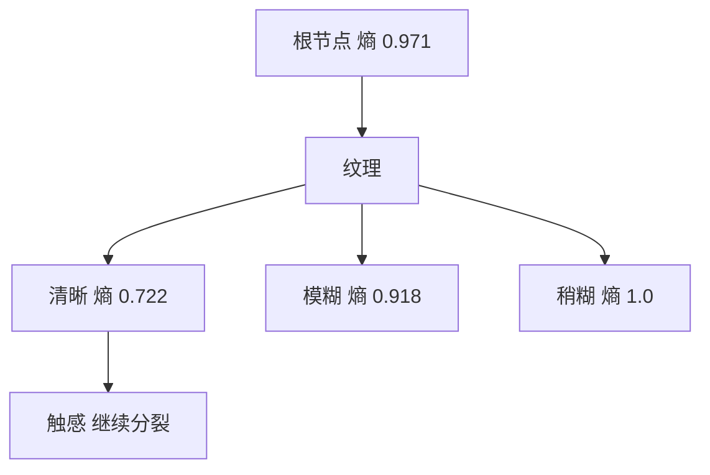

# 第 4 章：决策树

- **难度**：★★★ | **预估学时**：4 小时 | **前置**：第 3 章、信息论基础概念

## 学习目标
学完本章，你能：手算一个二分类数据集的信息熵与信息增益；说清信息增益、增益率、基尼指数三者的取舍；解释预剪枝与后剪枝的差别及各自风险；说明连续值离散化和缺失值处理的做法。

## 一句话核心
决策树每次挑一个“最能一次把混杂样本分开”的特征做分裂，判据就是分裂前后不确定性下降多少。

## 零基础讲解

### 概念 1：信息熵与信息增益（难度：进阶）
熵衡量一堆样本的“混杂程度”：`Ent(D) = -Σ p_k log2 p_k`。全是同一类时熵为 0；两类各占一半时熵为 1（二分类最大值）。

**信息增益**：用某个特征 a 分裂后，各子集的熵按样本比例加权平均，再用父节点熵减去它：`Gain(D,a) = Ent(D) - Σ(|D_v|/|D|) Ent(D_v)`。

**实例**：10 个样本，6 好 4 坏。Ent = -0.6log2(0.6)-0.4log2(0.4) = 0.971。
按“纹理”分：清晰 5 个（4 好 1 坏），模糊 3 个（1 好 2 坏），稍糊 2 个（1 好 1 坏）。
Ent(清晰)= -0.8log0.8-0.2log0.2=0.722；Ent(模糊)=0.918；Ent(稍糊)=1.0。
加权 = (5/10)×0.722 + (3/10)×0.918 + (2/10)×1.0 = 0.361+0.275+0.2 = 0.836。
Gain = 0.971-0.836 = 0.135。

### 概念 2：三种判据的取舍（难度：进阶）
- **信息增益**偏向取值多的特征。极端例子：用“编号”分裂，每个子集只有一个样本，熵全为 0，增益最大，但毫无泛化能力。
- **增益率**：`Gain_ratio = Gain / IV(a)`，其中 IV 是特征自身的固有值，取值越多 IV 越大，起到惩罚作用。但增益率又偏向取值少的特征，所以书上用“先筛信息增益高于平均的，再从中选增益率最高”的启发式。
- **基尼指数**：`Gini(D) = 1 - Σ p_k²`，含义是“随机抽两个样本，类别不一致的概率”。它不取对数，计算更快，CART 树用它。

### 概念 3：剪枝（难度：高难）
- **预剪枝**：分裂前先估计泛化性能，不提升就不分。风险是把当前看起来没用的分裂（但后续可能有用）提前砍掉，容易欠拟合。
- **后剪枝**：先长成完整树，再自底向上把子树替换成叶节点，若验证集性能提升就保留替换。效果通常更好，但要先训练完整棵树，代价更大。

**实例**：某节点分裂后训练准确率 100%（因为每个叶只有一两个样本），验证准确率却从 70% 掉到 65%。这说明分裂在记忆噪声，应该剪掉。

### 概念 4：连续值与缺失值（难度：进阶）
**连续值**：把该特征排序，取相邻值中点做候选划分点，算每个划分点的信息增益，取最优。同一特征可以被反复用不同阈值分裂。

**缺失值**：给每个样本加权重。分裂时只用在“该特征有值”的样本上算增益，再乘以“有值样本占比”作为惩罚；划分子集时，缺失样本按各子集的样本比例同时进入所有子集，权重按比例拆分。

## 图示

看图说明：每个节点的熵写在下面。分裂的目标是让子节点的熵尽量低，Parent 熵减去加权子熵就是这次分裂的收益。

## 常见误解
- 别以为信息增益最大的特征一定该选——实际上取值多的特征会被系统性偏爱，这是它的已知缺陷。
- 别以为剪枝会让模型变差——实际上剪枝几乎总是提升泛化，只是可能略降训练准确率。
- 别以为决策树不需要特征归一化就万事大吉——实际上它对特征尺度不敏感是真的，但类别特征编码方式仍会明显影响分裂结果。

## 自测题（答案）
1. 二分类问题中熵的最大值是多少？（答案：B；解析：两类各 0.5 时 -0.5log0.5×2=1。）
   - A. 0.5　B. 1　C. 2　D. log2(n)
2. 用“编号”作为特征分裂会导致？（答案：A；解析：每个子集只有一个样本熵为 0，信息增益最大但完全没有泛化能力。）
   - A. 信息增益最大但泛化极差　B. 增益为负　C. 无法分裂　D. 自动剪枝
3. 后剪枝相对预剪枝的优势是？（答案：C；解析：先长全再回退，避免了过早砍掉有用的分裂，通常泛化更好。）
   - A. 计算量更小　B. 训练更快　C. 不易欠拟合　D. 不需要验证集

## 复习锚点
- 熵 = 混杂度；信息增益 = 分裂后混杂度降了多少。
- 信息增益偏多值特征，增益率偏少值特征，基尼更快。
- 预剪枝易欠拟合，后剪枝效果好但更贵。
