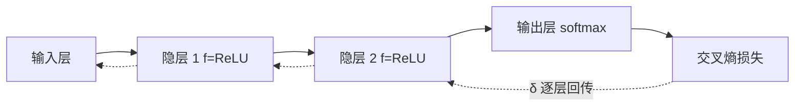

# 第 5 章：神经网络

- **难度**：★★★ | **预估学时**：4 小时 | **前置**：第 3、4 章、链式法则

## 学习目标
学完本章，你能：写出一个多层前馈网络的完整前向与反向公式；解释为什么 sigmoid 会导致梯度消失、ReLU 为什么缓解；说清“局部极小”和“全局最小”的区别与常用跳出策略。

## 一句话核心
神经网络是一族参数化的非线性函数，训练就是用梯度下降在参数空间里找让损失小的那一点。

## 零基础讲解

### 概念 1：网络结构与记号（难度：基础）
输入层不算层数。一个“单隐层网络”就是输入→隐层→输出三段。第 l 层的输出 `a^(l) = f(W^(l) a^(l-1) + b^(l))`，f 是激活函数。

**万能近似**：只要有足够多的隐层神经元，单隐层网络能以任意精度逼近任意连续函数。注意这句话只保证“存在”，不保证“梯度下降能找到”，也不说明需要多少神经元。

### 概念 2：反向传播公式（难度：高难）
定义误差项 `δ^(l) = ∂L/∂z^(l)`。输出层：`δ^(L) = ∇_a L ⊙ f'(z^(L))`。隐藏层递归：`δ^(l) = (W^(l+1))ᵀ δ^(l+1) ⊙ f'(z^(l))`。参数梯度：`∂L/∂W^(l) = δ^(l) (a^(l-1))ᵀ`，`∂L/∂b^(l) = δ^(l)`。

**每一行的意思**：先把误差从输出层往回“传”（乘以转置的权重矩阵），再乘上本层激活的导数（因为激活也是运算的一环）。这两步合起来就是链式法则。

### 概念 3：梯度消失与激活选择（难度：高难）
sigmoid 导数最大 0.25，多层连乘后浅层梯度趋近 0。ReLU 正区导数 1，梯度能原样传回，但负区恒 0 会导致神经元死亡。

**初始化配合**：ReLU 用 He（标准差 √(2/n)），sigmoid 用 Xavier（1/√n）。初始化太小信号逐层衰减，太大逐层饱和。

### 概念 4：局部极小与全局最小（难度：进阶）
损失曲面通常非凸，梯度下降只能保证到局部极小或鞍点。常用对策：
- **多组初始化**取验证最好的；
- **模拟退火**：以一定概率接受变差的解，前期概率大后期小；
- **随机梯度下降**：mini-batch 带来的噪声本身有助于跳出尖的局部极小；
- **动量**：借惯性冲过浅坑。

## 图示

看图说明：实线是前向，虚线是误差项 δ 的回传方向。注意回传乘的是权重矩阵的转置，这是形状能对上的关键。

## 常见误解
- 别以为万能近似定理说明单隐层就够用——实际上它只说存在性，深层网络能用指数少的参数表达同样函数。
- 别以为梯度下降一定找到最优——实际上非凸问题里它只保证局部性质。
- 别以为 ReLU 一定比 sigmoid 好——实际上小网络、需要概率输出时 sigmoid 仍有位置。

## 自测题（答案）
1. 输出层误差项 δ 怎么算？（答案：B；解析：损失对输出的梯度与该层激活导数逐元素相乘。）
   - A. 直接等于损失　B. 损失对输出的梯度 ⊙ 激活导数　C. 权重矩阵乘输出　D. 恒为 1
2. 隐层误差项回传时要乘什么？（答案：C；解析：乘下一层权重矩阵的转置，再乘本层激活导数。）
   - A. 本层权重　B. 学习率　C. 下一层权重的转置 ⊙ 本层激活导数　D. 输入特征
3. ReLU 的“神经元死亡”指？（答案：A；解析：输入长期为负时梯度恒 0，参数不再更新。）
   - A. 梯度恒 0 参数不再更新　B. 输出恒为 1　C. 权重被清零　D. 计算溢出

## 复习锚点
- 前向是矩阵乘法套激活，反向是 δ 回传乘转置权重。
- sigmoid 导数 ≤0.25，深了必消失；ReLU 缓解但会死。
- 非凸曲面只有局部保证，要靠多初始化、动量、噪声。
