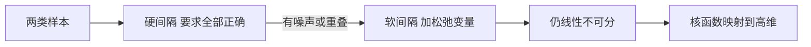

# 第 6 章：支持向量机

- **难度**：★★★ | **预估学时**：5 小时 | **前置**：第 3 章、拉格朗日乘子与二次规划

## 学习目标
学完本章，你能：写出硬间隔 SVM 的原问题并说明为什么标签取 ±1；推出对偶形式并解释支持向量的含义；说清核函数的作用与核技巧为什么不用真的映射到高维；写出软间隔的松弛变量与惩罚系数 C 的作用。

## 一句话核心
SVM 找一个“离两边都尽量远”的分界面；它只由少数几个最难分的样本（支持向量）决定，其余样本删掉也不影响结果。

## 零基础讲解

### 概念 1：间隔与标签取 ±1（难度：进阶）
分界面 `wᵀx+b=0`，点到面的距离是 `|wᵀx+b|/||w||`。要求所有样本满足 `y_i(wᵀx_i+b) ≥ 1`——这里把标签取 +1/-1 是关键：若取 0/1，(1-y) 与 (0-y) 会让约束不对称，公式得写两套。

间隔宽度是 `2/||w||`，所以“最大化间隔”等价于“最小化 ||w||²/2”，写成 `min ½||w||² s.t. y_i(wᵀx_i+b)≥1`。

**为什么间隔要归一化**：同一条直线有无穷组 (w,b)（同时放大 k 倍还是同一条线）。固定 `y_i(wᵀx_i+b)=1` 就把尺度钉死，间隔才有确定值。

### 概念 2：对偶与支持向量（难度：高难）
引入拉格朗日乘子 α_i≥0，得到对偶问题：`max Σα_i - ½ΣΣ α_iα_jy_iy_j(x_iᵀx_j)`，约束 `Σα_iy_i=0, α_i≥0`。

**KKT 条件给出关键结论**：`α_i > 0` 的样本必须落在间隔边界上，这些就是**支持向量**；`α_i=0` 的样本对 w 没有贡献。所以 w 只由支持向量决定。

**实例（三点的经典例子）**：正例 (1,1)、(-1,-1)，负例 (0,0) 时无解；换成 (2,2)、(2,0) 正例，(0,0)、(0,2) 负例时，可以算出支持向量是 (2,2)、(2,0)、(0,0)、(0,2) 中的三个，w=(2,2)，b=-2，间隔边界是 x1+x2=1 与 x1+x2=3。

### 概念 3：核函数与核技巧（难度：高难）
线性不可分时，把 x 映射到高维 φ(x)，在高维里线性可分。但直接算 φ 可能维度爆炸。**核技巧**：如果对偶里只需要内积 `φ(x_i)ᵀφ(x_j)`，那就直接定义一个核函数 `k(x_i,x_j)` 等于这个内积，完全不用显式构造 φ。

**常用核**：线性核 `x_iᵀx_j`；多项式核 `(x_iᵀx_j)^d`；高斯核 `exp(-||x_i-x_j||²/2σ²)`，对应无穷维映射。高斯核的 σ 越小，模型越复杂、越容易过拟合。

### 概念 4：软间隔（难度：进阶）
现实数据有噪声，硬间隔会为了一个异常点把边界挤歪。引入松弛变量 ξ_i≥0，约束放宽为 `y_i(wᵀx_i+b) ≥ 1-ξ_i`，目标改成 `min ½||w||² + CΣξ_i`。

**C 的作用**：C 大 → 惩罚违规重 → 尽量不分错、间隔窄、易过拟合；C 小 → 容忍违规 → 间隔宽、更稳。

## 图示

看图说明：这是一条“逐步放宽”的路线。每往右一步，模型能力增强，过拟合风险也增加。

## 常见误解
- 别以为 SVM 一定要把所有样本都用上——实际上只有支持向量起作用，删掉其余样本模型不变。
- 别以为核函数就是“先映射再算内积”——实际上核技巧根本不做映射，只在原空间算一个函数值。
- 别以为 C 越大越好——实际上 C 太大会死守每个噪声点，泛化变差。

## 自测题（答案）
1. SVM 标签取 +1/-1 而非 0/1 的原因是？（答案：B；解析：使约束 y_i(wᵀx_i+b)≥1 对称统一，0/1 会导致两类约束形式不同。）
   - A. 计算更快　B. 约束形式统一对称　C. 便于核函数　D. 防止除零
2. α_i>0 对应的样本是？（答案：A；解析：KKT 互补松弛条件，只有间隔边界上的样本 α 非零。）
   - A. 支持向量　B. 噪声点　C. 所有样本　D. 离边界最远的点
3. 高斯核的 σ 变小会导致？（答案：C；解析：核更尖锐，模型更复杂，容易过拟合。）
   - A. 模型更简单　B. 变成线性核　C. 更易过拟合　D. 间隔变宽

## 复习锚点
- 目标是最大化间隔，等价于最小化 ½||w||²。
- w 只由支持向量决定，其余样本可删。
- 核技巧：只算内积，不构造高维映射。
- C 控惩罚，σ 控核宽度，两个都是过拟合的旋钮。
