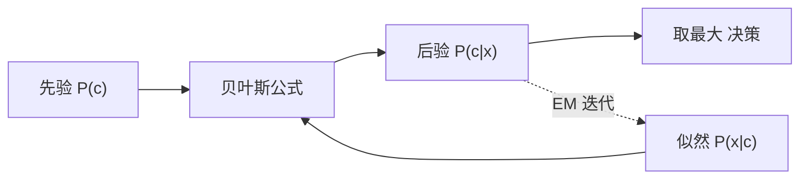

# 第 7 章：贝叶斯分类器

- **难度**：★★★ | **预估学时**：4 小时 | **前置**：第 2 章、条件概率与贝叶斯公式

## 学习目标
学完本章，你能：写出贝叶斯最优分类器的决策规则；推导朴素贝叶斯的条件独立性假设并手算一个分类例子；解释拉普拉斯修正为什么必要；说清 EM 算法在做什么、为什么需要它。

## 一句话核心
贝叶斯分类器用“先验 + 似然”算后验概率，取后验最大的类；朴素贝叶斯为了能算，硬假设特征之间条件独立。

## 零基础讲解

### 概念 1：贝叶斯决策（难度：基础）
`P(c|x) = P(c)P(x|c)/P(x)`。P(x) 对所有类相同，可以忽略，所以判据是 `argmax_c P(c)P(x|c)`。这就是**贝叶斯最优分类器**，它在“已知真实分布”时错误率最小。

**最小风险 vs 最小错误率**：如果判错的代价不同（把病人误判为健康比反过来严重得多），就要把代价乘进决策里，`argmax_c Σ_j λ_ij P(c_j|x)`。

### 概念 2：朴素贝叶斯（难度：进阶）
`P(x|c)` 是联合分布，特征多时组合爆炸，根本估不出来。**条件独立性假设**：在给定类别下，各特征相互独立，于是 `P(x|c)=Π P(x_i|c)`。

**实例（西瓜）**：判“好瓜”，特征（色泽=青绿, 敲声=清脆, 纹理=清晰）。
P(好)=0.6，P(坏)=0.4。
好瓜里：青绿 3/6，清脆 4/6，清晰 5/6 → 似然 = 0.6×0.5×0.667×0.833 = 0.167。
坏瓜里：青绿 1/4，清脆 1/4，清晰 1/4 → 似然 = 0.4×0.25×0.25×0.25 = 0.00625。
0.167 > 0.00625，判好瓜。

**拉普拉斯修正**：某特征值在某类中没出现过，概率为 0，连乘把整个后验打成 0。修正做法是分子加 1、分母加该特征取值数：`P(x_i|c) = (count+1)/(N_c + N_i)`。这等于给每个取值一个先验计数，避免“没见过就绝对不可能”。

### 概念 3：半朴素贝叶斯与 EM（难度：高难）
**半朴素**：放宽独立性，允许特征之间有“独依赖”（每个特征最多依赖另一个特征），如 SPODE、TAN。既保留可算性，又减少假设过强的偏差。

**EM 算法**：数据有缺失或含隐变量时，无法直接算后验。EM 的做法是：E 步用当前参数估计隐变量的期望（补全数据），M 步用补全后的数据重新估参数，反复迭代。**它保证似然单调不减，但只收敛到局部最优**，初值影响结果。

## 图示

看图说明：上半部分是分类流程，虚线是参数未知时的循环：先猜参数算后验，再用后验更新参数。

## 常见误解
- 别以为朴素贝叶斯的“朴素”是缺点就一定要避免——实际上特征独立性假设虽强，但在文本分类等任务上表现相当好，因为它只需要估少量参数。
- 别以为拉普拉斯修正只是“加个 1 方便”——实际上它等价于引入一个均匀先验，是贝叶斯平滑，有理论依据。
- 别以为 EM 一定收敛到全局最优——实际上它对初值敏感，多跑几次取最优是常规操作。

## 自测题（答案）
1. 某特征值在某类中从未出现，不修正会发生什么？（答案：C；解析：概率为 0，连乘后整个后验为 0，该类别被彻底排除。）
   - A. 概率为 1　B. 自动忽略该特征　C. 后验被乘成 0　D. 报错
2. EM 算法的保证是？（答案：B；解析：似然单调不减，但只到局部最优。）
   - A. 一定到全局最优　B. 似然单调不减　C. 一步收敛　D. 无需初值
3. 贝叶斯最优分类器在已知真实分布时？（答案：A；解析：它最小化错误率，是该条件下的理论最优。）
   - A. 错误率最小　B. 训练最快　C. 一定不过拟合　D. 需要核函数

## 复习锚点
- 后验正比于先验 × 似然，P(x) 可忽略。
- 朴素 = 条件独立假设，把联合概率拆成连乘。
- 拉普拉斯修正防零概率，本质是加先验。
- EM：E 步补隐变量，M 步更新参数，似然单调不减。
