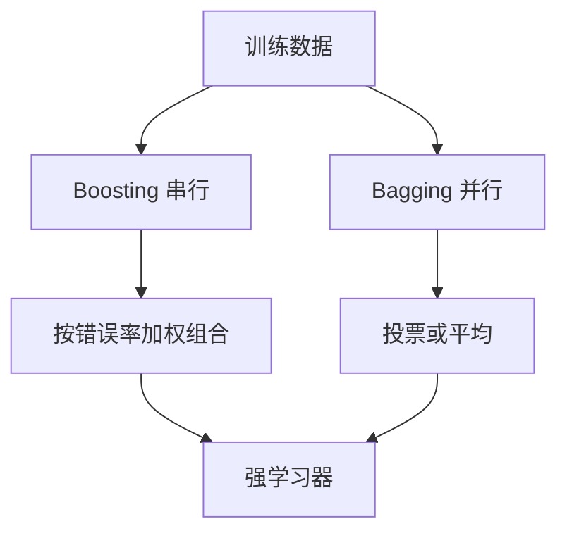

# 第 8 章：集成学习

- **难度**：★★★ | **预估学时**：4 小时 | **前置**：第 4、6、7 章

## 学习目标
学完本章，你能：说清 Boosting 与 Bagging 的根本差别；手推 AdaBoost 的样本权重更新公式并算一轮；解释随机森林的两处随机性各解决什么问题；说明 Stacking 为什么容易过拟合。

## 一句话核心
集成靠“好而不同”：每个基学习器要有一定准确率，且彼此的错不能重叠，这样投票才能把各自的错抵消掉。

## 零基础讲解

### 概念 1：Boosting 与 Bagging 的分工（难度：进阶）
- **Boosting**：串行，每个新学习器专门去纠正前面学错的部分，最后加权组合。代表 AdaBoost、GBDT。它主要降**偏差**。
- **Bagging**：并行，用自助采样训练多个独立学习器再投票。它主要降**方差**。

**为什么是这个分工**：Boosting 每轮都改样本分布让后面的模型关注难例，整体拟合能力不断增强；Bagging 每个模型看的是略有不同的数据，平均后噪声被抵消。

### 概念 2：AdaBoost 的权重更新（难度：高难）
第 t 轮：在当前权重分布 D_t 上训练基学习器 h_t，算它的加权错误率 `ε_t = P_{D_t}(h_t 判错)`。基学习器权重 `α_t = ½ ln((1-ε_t)/ε_t)`。样本权重更新：判错的乘 `exp(α_t)`，判对的乘 `exp(-α_t)`，再归一化。

**读公式**：ε_t 小于 0.5 时 α_t 为正，错样本权重被放大、对样本权重被缩小。所以下一轮模型被迫去啃上一轮错的样本。ε_t=0.5 时 α_t=0，该学习器等于没投票权。

**实例**：ε=0.2 时 α=½ln(0.8/0.2)=½ln4≈0.693。错样本权重乘 e^0.693≈2，对样本乘 0.5。一轮之后错样本占比翻四倍。

**为什么要求 ε<0.5**：若基学习器比随机猜还差，α 为负，加权投票等于把它反着用——理论上可行，实践中直接用“补集”更省事。

### 概念 3：随机森林的两处随机（难度：进阶）
1. **样本随机**：每棵树用自助采样的一份数据；
2. **特征随机**：每次分裂只在随机抽出的 k 个特征里选最优（k 常取 log2(d)）。

第二处随机性是关键：如果所有树都盯着同一个最强的特征分裂，树会长得很像，平均之后降方差的效果有限。限制特征选择逼每棵树看不同的证据，多样性才上来。

### 概念 4：Stacking（难度：高难）
用初级学习器的输出作为次级学习器的输入。**必须用交叉验证生成初级输出**，不能用训练集上的拟合值——否则初级模型在训练集上几乎完美，次级模型学到的是“谁过拟合得厉害”，而不是“谁泛化好”。

## 图示

看图说明：左边是串行改分布，右边是并行采样后平均。两条路的误差分解不同，选哪条取决于你的模型是高偏差还是高方差。

## 常见误解
- 别以为 Bagging 的树越多越好——实际上收益会饱和，而且树之间相关性高时收益很小。
- 别以为 AdaBoost 不会过拟合——实际上它的鲁棒性比一般 boosting 好，但噪声大、标签错误多的数据上仍会过拟合。
- 别以为随机森林不用调参——实际上树的深度、特征子集大小 k、树的数量都影响效果。

## 自测题（答案）
1. Bagging 主要降低的是？（答案：B；解析：多个模型独立训练再平均，抵消方差。）
   - A. 偏差　B. 方差　C. 计算量　D. 特征数
2. AdaBoost 中 ε=0.5 时 α 等于？（答案：A；解析：½ln(0.5/0.5)=0，该学习器无投票权。）
   - A. 0　B. 1　C. 0.5　D. 无穷大
3. 随机森林限制每次分裂只看 k 个特征，目的是？（答案：C；解析：逼各棵树看不同证据，提高多样性。）
   - A. 加速训练　B. 减少内存　C. 增加树间多样性　D. 防止过拟合到某一特征

## 复习锚点
- Boosting 降偏差、串行改分布；Bagging 降方差、并行采样。
- AdaBoost：α=½ln((1-ε)/ε)，错样本权重放大。
- 随机森林的两处随机：样本 + 特征子集。
- Stacking 要用交叉验证生成初级输出，否则必过拟合。
