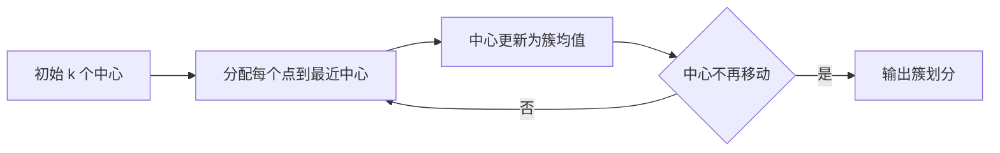

# 第 9 章：聚类

- **难度**：★★☆ | **预估学时**：3 小时 | **前置**：第 2 章、距离度量

## 学习目标
学完本章，你能：写出 k-means 的更新公式并手算一轮；解释它为什么对初值敏感、为什么只能收敛到局部最优；说清 DBSCAN 的“核心对象、密度可达”是什么意思；用轮廓系数评价聚类结果。

## 一句话核心
聚类没有标签，评价标准只能来自数据本身的“紧不紧、分不分得开”。

## 零基础讲解

### 概念 1：k-means（难度：进阶）
目标：`min ΣΣ ||x - μ_i||²`（每个点到它所属中心的平方距离和）。
迭代两步：**分配**——每个点归到最近的中心；**更新**——每个中心改成所属点的均值。两步都会让目标下降，所以必然收敛，但只保证局部最优。

**实例**：三个点 0、2、10，初始中心取 0 和 10。点 0→中心 0，点 2→中心 0（距离 2 < 8），点 10→中心 10。更新：中心变 (0+2)/2=1 和 10。下一轮：点 0→1，点 2→1，点 10→10，不再变化，收敛。若初始中心取 0 和 2，则点 10 归 2，中心变 1 和 10，结果不同——这就是初值敏感。

**k-means++**：第一个中心随机选，后续每个中心按“到已有中心距离平方”为概率选远的点，显著减少糟糕初值。

### 概念 2：学习向量量化 LVQ（难度：进阶）
有少量标签时用。每个原型向量带一个类别标记，样本来了找最近的原型：同类则把原型往样本方向拉，异类则推远。它是“用少量监督信息指导聚类”的典型。

### 概念 3：密度聚类 DBSCAN（难度：高难）
给定半径 ε 和最小点数 MinPts。**核心对象**：ε 邻域内样本数 ≥ MinPts 的点。从核心对象出发，把密度可达的点连成簇。不落在任何簇的点标为噪声。

**优点**：不用指定簇数，能发现任意形状的簇，能识别噪声。**缺点**：两个参数对结果影响大，高维数据上距离度量失效。

### 概念 4：层次聚类与评价（难度：进阶）
**AGNES**：每个点先自成一簇，每次合并距离最近的两簇，直到达到目标簇数。距离有最小、最大、平均三种定义，分别偏向链状、球状、均衡形状。

**轮廓系数**：对每个样本，`a` 是到本簇其他点的平均距离，`b` 是到最近其他簇的平均距离，`s=(b-a)/max(a,b)`。s 接近 1 说明分得好，接近 0 说明在边界，负值说明可能分错簇。全样本平均就是整体聚类质量。

## 图示

看图说明：这是一个必然终止的循环，因为每次迭代目标函数都严格下降且有限。但它停在哪个局部最优，取决于初值。

## 常见误解
- 别以为 k-means 收敛就说明结果对——实际上它只到局部最优，多跑几次取目标最小的。
- 别以为聚类一定要指定 k——实际上 DBSCAN 和层次聚类都不需要。
- 别以为轮廓系数越大就一定越好——实际上凸形簇上它偏袒球状划分，非凸数据上会误判。

## 自测题（答案）
1. k-means 每轮两步一定会让目标函数？（答案：A；解析：分配和更新各自都不增加平方距离和，故单调下降。）
   - A. 下降或不变　B. 上升　C. 震荡　D. 随机
2. DBSCAN 中“核心对象”指？（答案：C；解析：ε 邻域内样本数不少于 MinPts 的点。）
   - A. 离原点最近的点　B. 密度最大的簇中心　C. ε 邻域样本数≥MinPts 的点　D. 任何非噪声点
3. 轮廓系数为负说明？（答案：B；解析：b<a，样本离别的簇比本簇更近，划分可能有问题。）
   - A. 聚类很好　B. 样本可能分错簇　C. 簇数太多　D. 数据无结构

## 复习锚点
- k-means：分配—更新循环，局部最优，初值敏感。
- DBSCAN 靠密度连通，能找任意形状、能识别噪声。
- 轮廓系数衡量“簇内紧、簇间远”。
