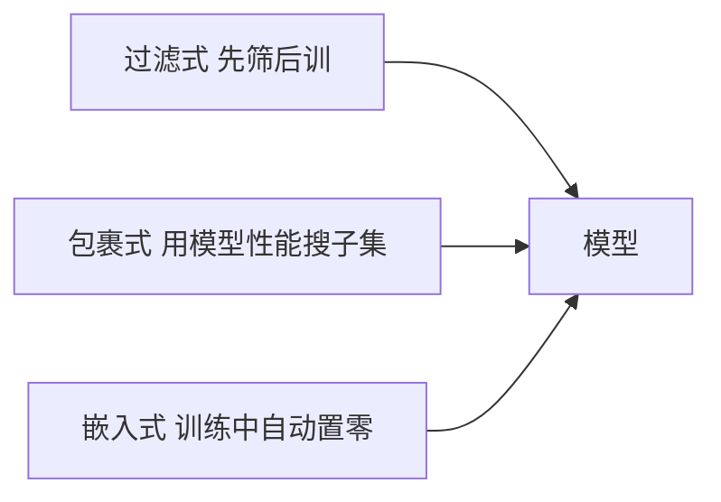

# 第 11 章：特征选择与稀疏学习

- **难度**：★★☆ | **预估学时**：3 小时 | **前置**：第 3、10 章

## 学习目标
学完本章，你能：区分过滤式、包裹式、嵌入式三种特征选择思路；用 Relief 的公式手算一个特征的权重更新；说明 L1 正则为什么能产生稀疏解而 L2 不能；解释“稀疏”为什么带来可解释性和计算优势。

## 一句话核心
特征选择不是“找最重要的特征”，而是“找出让模型在不掉分的前提下最省事的那个子集”。

## 零基础讲解

### 概念 1：三种范式（难度：进阶）
- **过滤式**：先按统计指标筛特征，再训练模型。与后续学习器无关，快但可能筛掉组合起来有用的特征。
- **包裹式**：把学习器当黑箱，用它的性能当评价标准搜特征子集。准但慢，容易过拟合到特定学习器。
- **嵌入式**：特征选择与训练一体，训练完权重为 0 的特征自动被剔除。典型是 L1 正则。

### 概念 2：Relief（难度：进阶）
对每个样本，找同类最近邻**猜中近邻**和异类最近邻**猜错近邻**，比较两者距离。特征 j 的权重更新：
`δ_j = -diff(x_i^j, x_nearhit^j)² + diff(x_i^j, x_nearmiss^j)²`，对所有样本累加。

**怎么读**：如果该特征上“同类邻居更近”，第一项小、第二项大，δ 为正，权重增加；反之减少。它衡量的是“这个特征能不能区分近邻的类别”。

**实例**：某特征在样本与其同类近邻上差 0.1，与异类近邻上差 0.5，则该样本贡献 -0.01+0.25=0.24，是强正贡献。

### 概念 3：L1 稀疏性（难度：高难）
L1 正则 `min L(w) + λ||w||_1`。几何解释：L1 的等值线是菱形（二维），顶点落在坐标轴上；平方误差的等值线是椭圆。椭圆扩张时最先碰到菱形的顶点，那里某个坐标为 0，于是解稀疏。L2 的等值线是圆，碰到的点一般两个坐标都非零。

**为什么稀疏有用**：高维数据里大量特征冗余，稀疏解等于自动做了特征选择，模型更轻、更可解释、推理更快。代价是 L1 在 0 点不可导，要用近端梯度（soft-thresholding）求解。

## 图示

看图说明：三条路对“评价标准”的定义不同：过滤式用统计量，包裹式用模型分数，嵌入式用损失函数本身。

## 常见误解
- 别以为特征越多模型越准——实际上冗余特征会增加方差和计算，噪声特征会直接伤害泛化。
- 别以为 L1 一定优于 L2——实际上特征高度相关时 L1 会随意挑一个保留，结果不稳定；L2 会把权重平摊，更稳但不稀疏。
- 别以为包裹式选出的特征一定最好——实际上它过拟合到特定学习器的风险很高。

## 自测题（答案）
1. L1 正则产生稀疏解的根本原因是？（答案：B；解析：L1 等值线是菱形，顶点在坐标轴上，最优点容易落在顶点。）
   - A. 梯度更大　B. 等值线有尖角落在坐标轴　C. 计算更快　D. 需要归一化
2. Relief 中某特征让同类邻居更近，其权重会？（答案：A；解析：-近同类差²+近异类差²，前者小后者大，δ 为正。）
   - A. 增加　B. 减少　C. 不变　D. 归零
3. 包裹式特征选择的主要风险是？（答案：C；解析：用特定学习器性能做准则，容易过拟合到该学习器。）
   - A. 计算太慢　B. 无法处理高维　C. 过拟合到特定学习器　D. 必须离散特征

## 复习锚点
- 过滤式看统计量、包裹式看模型分、嵌入式边训边选。
- Relief 用“同类近邻 vs 异类近邻”的距离差给特征打分。
- L1 的菱形尖角带来稀疏，L2 的圆形不会。
