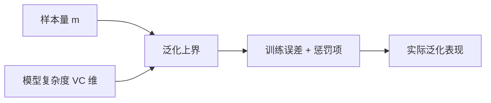

# 第 12 章：计算学习理论

- **难度**：★★★ | **预估学时**：3 小时 | **前置**：第 2 章、概率不等式

## 学习目标
学完本章，你能：说清 PAC 学习的三要素与“可能近似正确”到底保证了什么；解释 VC 维的含义并举例说明二维线性分类器的 VC 维是 3；写出泛化误差上界的大致形式并说明它和样本量、VC 维的关系。

## 一句话核心
计算学习理论回答一个问题：需要多少样本，才能保证学出来的模型在没见过的数据上也差不多好。

## 零基础讲解

### 概念 1：PAC 学习（难度：进阶）
PAC（Probably Approximately Correct）说：对任意目标概念、任意分布，只要有足够多的样本，学习算法能以高概率（置信度 1-δ）输出一个误差不超过 ε 的假设。

**三要素**：ε（允许的误差）、δ（允许失败的概率）、样本复杂度 m(ε,δ)。**注意它没说“一定正确”**，只说“大概率差不多对”，这是所有实用保证的原型。

### 概念 2：VC 维（难度：高难）
假设空间 H 的 VC 维，是“能被 H 打散（shatter）的最大样本集大小”。**打散**指：这组样本的所有 2^m 种标记组合，都能被 H 中某个假设实现。

**二维线性分类器**：3 个不共线的点可以被打散（8 种标记全实现）；4 个点不行（对角同色就画不出）。所以 VC 维是 3。

**为什么 VC 维重要**：它衡量假设空间的表达能力，且与具体分布无关。VC 维高，模型能拟合复杂模式，但泛化上界更松。

### 概念 3：泛化误差上界（难度：高难）
对有限假设空间，以至少 1-δ 的概率有：`E(h) ≤ Ê(h) + √(ln|H| + ln(1/δ))/(2m)`，其中 Ê 是训练误差，m 是样本数，|H| 是假设数。

**怎么读**：训练误差 + 一个“复杂度惩罚项”。样本越多惩罚越小，假设空间越大惩罚越大。这就是“模型容量与数据量要匹配”的数学来源。

用 VC 维替 ln|H| 得到与分布无关的界，形式类似但常数不同。这些界通常很松（常数大），所以实际中更多用来做定性判断而非精确预测。

### 概念 4：稳定性（难度：进阶）
算法稳定性：训练集换掉一个样本，输出模型的损失变化不超过 β。**稳定算法的泛化误差可用 β 给出界**，这是比 VC 维更精细的路径，因为它利用算法本身而非假设空间的容量。

## 图示

看图说明：样本量与复杂度是两根杠杆。数据少就选简单模型，数据多才敢上复杂模型。

## 常见误解
- 别以为 VC 维越高越差——实际上它只说明需要更多样本，如果有足够数据，高 VC 模型可以更好。
- 别以为这些界能直接预测准确率——实际上它们通常极松，作用是把“为什么需要更多数据/更简单模型”讲清楚。
- 别以为 PAC 保证了算法的实际表现——实际上它只给概率意义上的界，不保证每次运行都对。

## 自测题（答案）
1. 二维线性分类器的 VC 维是？（答案：B；解析：3 个不共线点可打散，4 个点不行。）
   - A. 2　B. 3　C. 4　D. 无穷
2. 泛化上界中的惩罚项随样本量 m 如何变化？（答案：A；解析：项中含 1/√m，m 增大则惩罚减小。）
   - A. 随 m 增大而减小　B. 随 m 增大而增大　C. 与 m 无关　D. 先增后减
3. PAC 的“可能近似正确”指？（答案：C；解析：以高概率输出误差不超过 ε 的假设，不是保证绝对正确。）
   - A. 一定正确　B. 误差为零　C. 大概率误差小　D. 对所有分布都完美

## 复习锚点
- PAC = 高概率 + 小误差，代价是样本量。
- VC 维 = 能被打散的最大样本数；二维线性是 3。
- 泛化上界 = 训练误差 + 复杂度/√样本量。
