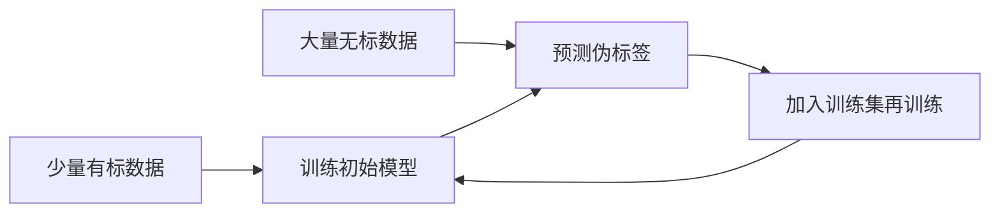

# 第 13 章：半监督学习

- **难度**：★★★ | **预估学时**：3 小时 | **前置**：第 7、9、12 章

## 学习目标
学完本章，你能：说清半监督学习能奏效的两个假设；区分纯半监督学习与直推学习；解释生成式方法、半监督 SVM、图半监督三条路线的差别；说明协同训练为什么要求“视图充分且独立”。

## 一句话核心
半监督学习靠“未标注数据的分布本身携带信息”这一点：聚类结构、流形结构、或两个视角的一致性。

## 零基础讲解

### 概念 1：两个基本假设（难度：进阶）
- **聚类假设**：决策边界应该穿过数据稀疏的区域，而不是密集区。
- **流形假设**：相邻样本的标记应该相似，因为它们落在同一块低维流形上。

这两个假设本质上是同一条：数据分布本身有结构，结构能约束分类边界。

**纯半监督 vs 直推**：纯半监督用未标注数据帮助训练，目标是预测**未来**的新样本；直推学习（transductive）就是要把**这批**未标注样本标出来，不关心新样本。

### 概念 2：三条技术路线（难度：高难）
1. **生成式方法**：假设所有数据（含未标注）来自同一个生成模型，用 EM 把未标注样本的隐含类别当隐变量估出来。它依赖生成模型假设正确，假设错了会拉低性能。
2. **半监督 SVM（S3VM）**：要求分类边界不仅分开有标样本，还要穿过低密度区。优化时给未标注样本也分配松弛变量，是非凸问题，常用凸放松或梯度下降近似。
3. **图半监督**：把样本建成图，边权是相似度，标签像“热量”一样沿边扩散。解是一个稀疏线性方程组，未标注样本的标签由邻居加权决定。

**实例（图方法）**：三个点 A(有标+1)、B(无标)、C(有标-1)，相似度 A-B=0.9、B-C=0.1。B 的标签 = (0.9×1 + 0.1×(-1))/(0.9+0.1) = 0.8，判 +1。直观上 B 更像 A。

### 概念 3：协同训练（难度：高难）
要求数据有两个**充分且独立**的视图（比如网页的正文和超链接）。两个视图各训一个分类器，各自把最有把握的未标注样本加上伪标签给对方，互相教。

**为什么要求视图独立**：如果两个视图高度相关，一个分类器的错误会被另一个复制，互相教等于一起错。独立性保证错误不重叠。

## 图示

看图说明：这是一个自训练循环。风险在于伪标签一旦错，会被反复强化，所以要选高置信样本、控制比例。

## 常见误解
- 别以为无标数据一定有用——实际上如果无标数据分布与有标数据差异大，反而会伤害模型。
- 别以为半监督一定优于监督——实际上有标数据足够多时，半监督的收益很小甚至为负。
- 别以为协同训练随便两个视图就行——实际上视图不独立时，互相教就是互相传错。

## 自测题（答案）
1. 半监督学习能奏效的根本依据是？（答案：B；解析：聚类或流形假设，即数据分布本身含结构信息。）
   - A. 无标数据更多　B. 数据分布本身含结构　C. 模型更强　D. 计算更快
2. 协同训练要求两个视图？（答案：C；解析：充分且独立，保证错误不重叠。）
   - A. 完全相同　B. 完全不相关　C. 充分且独立　D. 都是文本
3. 直推学习与纯半监督的差别是？（答案：A；解析：直推只要标出当前这批无标样本，不追求泛化到新样本。）
   - A. 不追求对新样本泛化　B. 不需要有标数据　C. 必须用深度学习　D. 一定有图结构

## 复习锚点
- 两个假设：聚类（边界走稀疏区）、流形（近邻标签相似）。
- 三条路线：生成式、S3VM、图扩散。
- 协同训练的前提是视图独立，否则互相传错。
