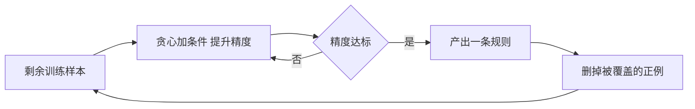

# 第 15 章：规则学习

- **难度**：★★☆ | **预估学时**：3 小时 | **前置**：第 4 章、逻辑基础

## 学习目标
学完本章，你能：说明规则学习与决策树的异同；用序贯覆盖的思路描述如何一条条长出规则；解释规则剪枝的两种做法；说清归纳逻辑程序设计（ILP）为什么需要背景知识。

## 一句话核心
规则学习直接产出“如果……那么……”的命题，天生可读、可修改、可解释，代价是搜索空间大。

## 零基础讲解

### 概念 1：规则与覆盖率（难度：基础）
一条规则形如 `好瓜 ← 色泽=青绿 ∧ 敲声=沉闷`。它覆盖的样本是“所有满足左边条件的样本”，其中正例比例叫**精度**，覆盖的正例数量叫**覆盖度**。

**与决策树的差别**：决策树是“一条路径一条规则”，规则之间互斥且完备；规则集里的规则可以重叠、可以不完备（有些样本没有规则覆盖）。所以规则集更灵活，也更容易处理缺省情况。

### 概念 2：序贯覆盖（难度：进阶）
从空规则开始，每次加一个最能提升精度的条件（贪心），直到规则只覆盖正例或精度达标；然后把这条规则覆盖的正例删掉，在剩余样本上重复。**这是“分治”策略：一条规则解决一部分，剩下的继续。**

**实例**：训练集 10 正 10 负。第一轮找到条件“纹理=清晰”，覆盖 6 正 1 负，精度 0.857；再加“触感=硬”，覆盖 3 正 0 负，精度 1.0，规则成立。删掉这 3 个正例，继续下一轮。

### 概念 3：剪枝（难度：进阶）
- **预剪枝**：加条件时同时看验证集，精度不升就停。
- **后剪枝**：先长成很长的规则，再逐个删条件，若验证集精度提升就保留删除。

规则后剪枝比树后剪枝更简单，因为删一个条件就是删一个合取项。

### 概念 4：归纳逻辑程序设计（难度：高难）
命题规则表达能力有限（不能表达“存在某个瓜比它甜”）。**ILP** 用一阶逻辑表示规则，允许引入背景知识（比如“更甜”这个谓词的定义）。

**为什么需要背景知识**：一阶规则的空间是无限的，没有背景知识约束，搜索无从下手。ILP 的典型做法是最小一般化：从最具体的规则出发，每次做一次“提升”，逐步泛化。

## 图示

看图说明：这是一个“吃完一批再吃下一批”的循环。每轮只关心还没被解释的样本，这是它和决策树最大的不同。

## 常见误解
- 别以为规则越多越好——实际上规则太多会过拟合，且规则之间可能冲突，需要投票或优先级。
- 别以为规则学习只能处理离散特征——实际上连续特征可以先离散化再用。
- 别以为 ILP 只是“规则的复杂版”——实际上它引入背景知识后能表达递归概念，这是命题规则做不到的。

## 自测题（答案）
1. 规则学习与决策树的主要差别是？（答案：B；解析：决策树路径互斥完备，规则集可重叠、可不完备。）
   - A. 规则学习不能分类　B. 规则集可重叠不完备　C. 决策树不可解释　D. 规则学习不需要数据
2. 序贯覆盖每产出一条规则后会做什么？（答案：A；解析：删掉被该规则覆盖的正例，在剩余样本上继续。）
   - A. 删掉被覆盖的正例　B. 删掉所有负例　C. 重新采样　D. 增加特征
3. ILP 需要背景知识的原因是？（答案：C；解析：一阶规则空间无限，无背景知识无法有效搜索。）
   - A. 提高准确率　B. 加速计算　C. 约束搜索空间　D. 避免过拟合

## 复习锚点
- 规则 = 条件合取 → 结论，用精度与覆盖度评价。
- 序贯覆盖：长一条、删覆盖、再长下一条。
- ILP 用一阶逻辑 + 背景知识，表达力强但搜索难。
