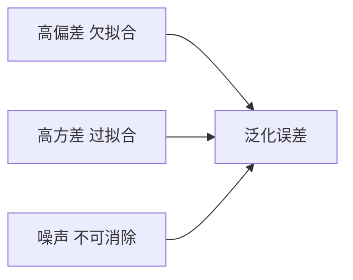

# 偏差与方差

- **难度**：进阶 | **涉及章节**：第 2、8 章

## 一句话定义
偏差是模型系统性偏离真实规律的程度，方差是模型对训练集扰动敏感的程度；泛化误差约等于偏差平方加方差加噪声。

## 为什么重要
它把“模型为什么不好”分成两类可分别处理的原因：欠拟合是高偏差，过拟合是高方差。集成方法的分工也由它决定。

## 图示

## 详解
偏差高表现为训练误差本身就大；方差高表现为训练误差小、验证误差大。降偏差靠增加模型容量、加特征、减少正则；降方差靠加数据、加正则、用 Bagging 平均。

一个具体的感受方式：用不同随机划分训练同一个模型，如果每次结果差异很大，方差就高；如果每次都稳定地差，偏差就高。

## 常见误解
**别以为偏差和方差能独立优化到最小**——实际上存在权衡，容量增加通常降偏差升方差。

## 在书中出现的脉络
| 章节 | 语境 | 关键结论 |
|---|---|---|
| 第 2 章 | 泛化误差分解 | 解释过拟合与欠拟合 |
| 第 8 章 | Boosting/Bagging | 前者降偏差，后者降方差 |

## 相关概念
- 前置：泛化误差、模型容量
- 后续：集成学习、正则化
