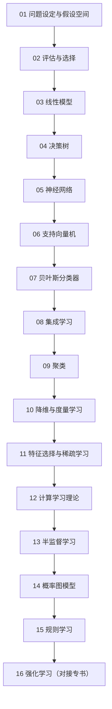

# 学习路径：机器学习（周志华）

## 路径总览

## 逐步展开

### 步骤 01：问题设定与假设空间
**阅读**：ch01
**检查点**：能用自己的话解释版本空间与 NFL
**目标**：建立“学习=在假设空间里筛选”的框架

### 步骤 02：评估与选择
**阅读**：ch02
**检查点**：给定混淆矩阵算出 P、R、F1，并说明为何要显著性检验
**目标**：能设计一套可信的评估流程

### 步骤 03：线性模型
**阅读**：ch03
**检查点**：推出最小二乘闭式解并解释为何用交叉熵
**目标**：掌握最基础的判别模型

### 步骤 04：决策树
**阅读**：ch04
**检查点**：手算一次信息增益与一轮剪枝判断
**目标**：理解“用判据贪心分裂”的思路

### 步骤 05：神经网络
**阅读**：ch05
**检查点**：写出 δ 的回传公式并解释梯度消失
**目标**：掌握参数化模型的训练机制

### 步骤 06：支持向量机
**阅读**：ch06
**检查点**：推出对偶并说明支持向量为何只占少数
**目标**：理解间隔最大化与核技巧

### 步骤 07：贝叶斯分类器
**阅读**：ch07
**检查点**：手算一次朴素贝叶斯分类并说明平滑的作用
**目标**：掌握概率视角的分类

### 步骤 08：集成学习
**阅读**：ch08
**检查点**：算一轮 AdaBoost 的 α 与权重更新
**目标**：理解偏差方差分解与集成分工

### 步骤 09：聚类
**阅读**：ch09
**检查点**：手算一轮 k-means 并用轮廓系数评价
**目标**：掌握无监督分组

### 步骤 10：降维与度量学习
**阅读**：ch10
**检查点**：推出 PCA 的最优方向并说明累计贡献率
**目标**：掌握维度压缩

### 步骤 11：特征选择与稀疏学习
**阅读**：ch11
**检查点**：解释 L1 为何稀疏并算一次 Relief 更新
**目标**：掌握特征层面的简化

### 步骤 12：计算学习理论
**阅读**：ch12
**检查点**：说明 VC 维与泛化上界的关系
**目标**：建立“需要多少数据”的判断

### 步骤 13：半监督学习
**阅读**：ch13
**检查点**：说明两个假设与三条路线
**目标**：掌握少标签场景的处理

### 步骤 14：概率图模型
**阅读**：ch14
**检查点**：用 d-分离判断独立性，说明汇连的反直觉
**目标**：掌握结构化概率建模

### 步骤 15：规则学习
**阅读**：ch15
**检查点**：描述序贯覆盖流程并说明 ILP 的作用
**目标**：掌握可解释的符号方法

### 步骤 16：强化学习（对接专书）
**阅读**：ch16
**检查点**：写出 Q-learning 更新式并对比 Sarsa
**目标**：把监督学习框架扩展到序列决策

## 学完全程后

