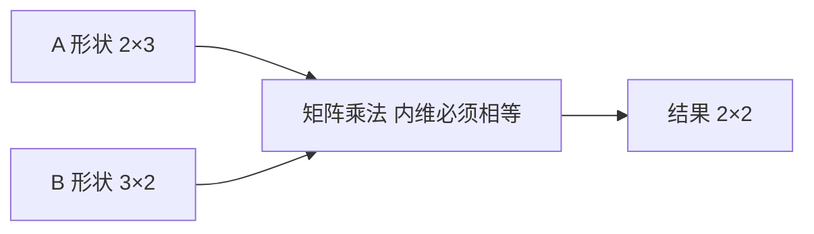

# 第 1 章：Python 入门

- **难度**：★☆☆ | **预估学时**：2 小时 | **前置**：无（会四则运算即可）

## 学习目标
学完本章，你能：把“标量、向量、矩阵、张量”按维数分清；判断两个数组能否相加、相乘；手算一个 2×3 与 3×2 的矩阵乘法，并说清结果为什么是 2×2。

## 一句话核心
深度学习里 90% 的代码在干一件事：把数据的形状（shape）摆对，然后做批量乘法。

## 零基础讲解

### 概念 1：数组的“维数”就是嵌套层数（难度：基础）
**标量**是一个数，比如 3.5；**向量**是一排数，比如 [1, 2, 3]；**矩阵**是一张表，2 行 3 列；再往上，三维数组可以想成“一摞表”。NumPy 用 `.shape` 告诉你它长什么样：`(3,)` 是一排 3 个数，`(2, 3)` 是 2 行 3 列，`(2, 3, 4)` 是 2 摞、每摞 2 行 3 列、每格 4 个数。

**为什么这件事重要**：神经网络的一次前向传播，本质是 `输出 = 输入 × 权重 + 偏置`，其中输入、权重、输出全是数组。形状对不上，乘法根本没法做。

### 概念 2：广播（broadcasting）（难度：基础）
两个形状不同的数组相加时，NumPy 会先把小的那个“铺开”到大的形状，再逐元素相加。规则是从最右边的维度开始对齐，某一维长度是 1 或缺失，就把它扩成对方的长度。

**类比**：拿一把最小刻度为 1 厘米的尺子去量三块长度不同的布。尺子本身没变长，只是它在每块布上重复使用。广播也是这个意思——数据没有真的被复制成一堆副本，只是在计算时按同一套下标去取值。

**类比失效的地方**：如果两个维度都大于 1 且不相等（比如 3 和 4），广播直接报错，不会“自动取平均”。这时候只能自己 reshape。

### 概念 3：矩阵乘法的维度规则（难度：基础）
`A` 的形状是 (m, n)，`B` 的形状是 (n, p)，那么 `A @ B` 的形状是 (m, p)。**左边的列数必须等于右边的行数**，两个 n 必须相等，否则报错。

计算方式是“行乘列再求和”：结果的第 i 行第 j 列，等于 A 的第 i 行 与 B 的第 j 列 逐项相乘后相加。

## 图示

看图说明：两个输入中间的“3”必须对上，对不上就是代码报错的根源；两端剩下的 2 和 2 决定了输出形状。

## 类比与实例
- 类比：矩阵乘法像一个班的成绩单乘以一套权重。成绩单是 30 行（30 个学生）5 列（5 门课），权重是 5 行 2 列（5 门课对 2 个指标的贡献），乘完得到 30 行 2 列——每个学生的 2 个综合指标。行数不变，列数变成权重的列数。
- 实例：手算 `A = [[1,2,3],[4,5,6]]`（2×3），`B = [[7,8],[9,10],[11,12]]`（3×2）。
  结果第 1 行第 1 列 = 1×7 + 2×9 + 3×11 = 7+18+33 = 58；
  第 1 行第 2 列 = 1×8 + 2×10 + 3×12 = 8+20+36 = 64；
  第 2 行第 1 列 = 4×7 + 5×9 + 6×11 = 28+45+66 = 139；
  第 2 行第 2 列 = 4×8 + 5×10 + 6×12 = 32+50+72 = 154。
  结果 `[[58,64],[139,154]]`，形状 2×2。可以用 `np.array([[1,2,3],[4,5,6]]) @ np.array([[7,8],[9,10],[11,12]])` 复算。

## 常见误解
- 别以为 `A * B` 和 `A @ B` 差不多——实际上 `*` 是逐元素相乘（形状必须一致或可广播），`@` 才是矩阵乘法。写错符号不会报错，只会算出毫无意义的数。
- 别以为广播会真的复制数据占内存——实际上 NumPy 只记录“某一维按 1 处理”，计算时按下标映射取值，内存不涨。

## 自测题（答案）
1. 形状 (2,3) 的数组与形状 (3,) 的数组相加，结果形状是？（答案：B；解析：从右对齐，3 与 3 相等，左边 2 保留，结果是 (2,3)，不是 (3,2)。）
   - A. (3,)　B. (2,3)　C. (2,)　D. 报错
2. 形状 (4,2) 与 (2,5) 做矩阵乘法，结果形状是？（答案：A；解析：内维 2=2 通过，外侧 4 与 5 组成 (4,5)。）
   - A. (4,5)　B. (2,5)　C. (4,2)　D. 报错
3. 为什么深度学习要用“批量”而不是一条一条算？（答案：B；解析：矩阵乘法一次处理整批数据，底层库能把运算压到接近硬件的极限，比循环快一到两个数量级。）
   - A. 因为批量算的结果更准　B. 因为矩阵运算能大幅提速　C. 因为不批量会报错　D. 因为批量能防止过拟合

## 复习锚点
- shape 是数组的“体检报告”，任何报错先看它。
- 矩阵乘法的唯一硬规则：左边列数 = 右边行数。
- 广播不是复制，是“按 1 扩展下标”。
