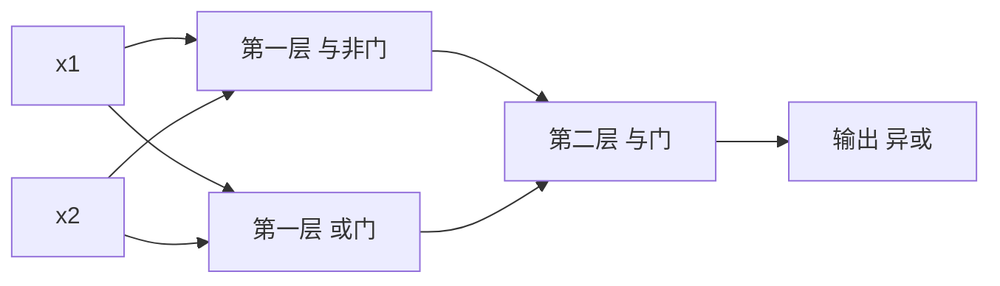

# 第 2 章：感知机

- **难度**：★☆☆ | **预估学时**：2 小时 | **前置**：第 1 章（数组与矩阵乘法）

## 学习目标
学完本章，你能：用权重和偏置写出与门、或门、与非门；说明为什么单层感知机画不出一条线来分开异或；手算出一个两层感知机解异或的完整输入输出。

## 一句话核心
感知机就是“加权求和，超过阈值就输出 1”；它能画的决策边界只有一条直线，所以异或必须叠两层。

## 零基础讲解

### 概念 1：感知机的计算式（难度：基础）
输入 x₁、x₂，权重 w₁、w₂，偏置 b。先算 `a = w₁x₁ + w₂x₂ + b`，再判断：a 大于 0 输出 1，否则输出 0。这个“大于 0 输出 1”的规则叫**阶跃函数**。

**偏置的作用**：它相当于把门槛整体平移。没有 b，直线必须过原点，很多分类就画不出来。

**实例：与门**。取 w₁=w₂=0.5，b=-0.7。代入：
- (0,0)：0+0-0.7=-0.7 → 0
- (0,1)：0+0.5-0.7=-0.2 → 0
- (1,0)：0.5+0-0.7=-0.2 → 0
- (1,1)：0.5+0.5-0.7=0.3 → 1
四种输入都对上了。改成 w=(0.5,0.5)、b=-0.2 就是或门；取 w=(-0.5,-0.5)、b=0.7 就是与非门。

### 概念 2：线性可分与异或的死结（难度：进阶）
把输入画成平面上的四个点：(0,0)、(0,1)、(1,0)、(1,1)。感知机能做的事，是用一条直线把输出 1 的点和输出 0 的点分开。异或要求 (0,0) 和 (1,1) 输出 0，(0,1) 和 (1,0) 输出 1——这两个 1 在对角线上，两个 0 在另一条对角线上，**任何一条直线都分不开**。

**类比**：两根绳子交叉成 X，你要用一根直的竹竿同时把左上和右下两块区域划到同一边，还要把右上和左下划到另一边。怎么摆都做不到。

**类比失效的地方**：如果允许把平面折弯（非线性变换），就能分开。这正是多层网络在做的事。

### 概念 3：叠加一层就解开了（难度：进阶）
用两个感知机各切一刀，再用第三个感知机把两刀的结果组合起来。
- 第一层第 1 个：与非门，w=(-0.5,-0.5)，b=0.7，输出 s₁
- 第一层第 2 个：或门，w=(0.5,0.5)，b=-0.2，输出 s₂
- 第二层：与门，w=(0.5,0.5)，b=-0.7，输入是 s₁、s₂

逐点验算：
- (0,0)：s₁=1，s₂=0 → 与门得 0.5+0-0.7=-0.2 → 0 ✓
- (0,1)：s₁=1，s₂=1 → 0.5+0.5-0.7=0.3 → 1 ✓
- (1,0)：s₁=1，s₂=1 → 1 ✓
- (1,1)：s₁=0，s₂=1 → 0+0.5-0.7=-0.2 → 0 ✓
异或解决。

## 图示

看图说明：注意第一层的两个神经元看的是同一份输入，第二层看的是第一层的两个输出。层与层之间只传数值，不传原始输入。

## 类比与实例
- 类比：判断一个人要不要发offer，先由两个面试官各自给一个“过/不过”，再由主面试官综合两人的结论。单个面试官只能按一条标准裁，两个标准交叉才可能覆盖复杂情况。
- 实例：上面异或的手算过程就是完整实例，四行输入全部验算过，可以直接照着写 `for x in [(0,0),(0,1),(1,0),(1,1)]` 跑一遍核对。

## 常见误解
- 别以为感知机只能做二分类、所以没用——实际上多层感知机是今天所有神经网络的前身，“加权求和 + 非线性”这个结构一直没变。
- 别以为权重是手算出来的——实际上上面那些数是为了讲清机制人为设定的。真实训练是从随机数出发，靠梯度一步步改。

## 自测题（答案）
1. 单层感知机无法实现异或，根本原因是？（答案：C；解析：单层只能产生一条线性决策边界，异或的两类点在同一条对角线上，线性不可分。）
   - A. 输入只有两个　B. 阶跃函数不可导　C. 决策边界只能是直线　D. 偏置取值不对
2. 把与门的 b 从 -0.7 改成 -1.5，会发生什么？（答案：D；解析：(1,1) 时 0.5+0.5-1.5=-0.5 不大于 0，输出变 0，四种输入全为 0，门失效。）
   - A. 变成或门　B. 变成与非门　C. 没有变化　D. 全部输出 0

## 复习锚点
- 感知机 = 加权求和 + 阈值判断；偏置负责平移门槛。
- 线性可分：能用一条直线分开才算。
- 异或靠“两层 + 非线性”解决，这是深层网络的起点。
