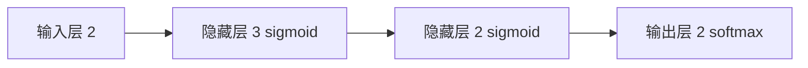

# 第 3 章：神经网络

- **难度**：★★☆ | **预估学时**：3 小时 | **前置**：第 2 章（感知机）

## 学习目标
学完本章，你能：说出 sigmoid、ReLU、阶跃三种激活函数的差别与各自的问题；用矩阵乘法写出一个三层网络的前向传播；解释 softmax 输出的每一维代表什么、为什么加起来等于 1。

## 一句话核心
神经网络 = 感知机叠层 + 把阶跃换成光滑的激活函数，这样才能求导、才能训练。

## 零基础讲解

### 概念 1：为什么必须换掉阶跃函数（难度：基础）
阶跃函数在 0 处从 0 直接跳到 1，导数在几乎所有位置都是 0、在 0 处不存在。训练要靠“梯度”告诉参数往哪改，导数全为 0 就等于没有任何信息。

**sigmoid**：σ(x)=1/(1+e^{-x})。它把任意实数压进 (0,1)，形状是一条平滑的 S 曲线，导数处处存在，而且可以写成 `σ'(x)=σ(x)(1-σ(x))`——只用函数值就能算导数，这对后面写反向传播非常关键。

**ReLU**：`max(0, x)`。小于 0 一律输出 0，大于 0 原样输出，导数只有 0 和 1 两种值。它比 sigmoid 简单得多，深层网络里更常用，因为 sigmoid 每层都把输出压在 0 到 1 之间，叠十几层之后梯度会越传越小。

**类比**：sigmoid 像一个谨慎的评审，永远只给 0 到 1 之间的分数，怎么催都不会给满分；ReLU 像一个粗暴的闸门，过线就全开，不过线就关死。

**类比失效的地方**：ReLU 的“关死”是真的关死——如果某个神经元的加权和长期小于 0，它的梯度恒为 0，参数再也不会更新，这叫“神经元死亡”。sigmoid 不会死，但会“变懒”。

### 概念 2：三层网络的前向传播（难度：进阶）
记号约定：`A^(1) = X @ W1 + b1`，`Z^(1) = sigmoid(A^(1))`，`A^(2) = Z^(1) @ W2 + b2`，`Z^(2) = sigmoid(A^(2))`，`A^(3) = Z^(2) @ W3 + b3`，输出 `Y = softmax(A^(3))`。

形状约定（这是最容易错的地方）：输入一批 2 条样本、每条 2 个特征，X 形状 (2,2)；W1 取 (2,3)，则 A^(1) 是 (2,3)；W2 取 (3,2)，A^(2) 是 (2,2)；W3 取 (2,2)，输出 (2,2)。**每一层的权重形状是“上一层神经元数 × 本层神经元数”**。

**为什么用矩阵形式**：如果一条一条算，每层要写一个循环；用矩阵，整批样本一次乘完，这就是第 1 章说的批量的意义。

### 概念 3：softmax 与输出的含义（难度：进阶）
softmax 对每个输出先取指数，再除以所有指数之和：`y_k = e^{a_k} / Σ e^{a_i}`。结果每个分量在 0 到 1 之间，并且加起来恰好等于 1，可以当成“属于第 k 类的概率”。

**关键性质**：取指数不改变大小顺序，所以 softmax 之后“哪个最大”和之前一样。分类任务真正关心的 argmax 不受影响。实际实现里为了避免 e^{大数} 溢出，会先把每个 a 减去其中的最大值，结果不变。

## 图示

看图说明：箭头上的数字是每层神经元个数，不是层数。权重矩阵的形状就是相邻两个数字组成的 (前, 后)。

## 类比与实例
- 类比：一条流水线上的三道工序。每道工序把半成品按固定比例重新组合（矩阵乘法），再用一个统一的整形模具压一下（激活函数）。模具必须是非线性的，否则三道线性工序叠起来等价于一道。
- 实例：取 x=(1.0, 0.5)，W1=[[0.1,0.2,0.3],[0.4,0.5,0.6]]，b1=(0.1,0.1,0.1)。
  A^(1) 第 1 个分量 = 1.0×0.1 + 0.5×0.4 + 0.1 = 0.1+0.2+0.1 = 0.4；
  第 2 个 = 1.0×0.2 + 0.5×0.5 + 0.1 = 0.2+0.25+0.1 = 0.55；
  第 3 个 = 1.0×0.3 + 0.5×0.6 + 0.1 = 0.3+0.3+0.1 = 0.7。
  sigmoid(0.4)=0.5987，sigmoid(0.55)=0.6341，sigmoid(0.7)=0.6682。数值可用 `1/(1+np.exp(-0.4))` 复算。

## 常见误解
- 别以为层数越多参数一定越多——实际上参数量由相邻层宽度决定，把隐藏层从 100 缩到 10，参数量可能反而减少。
- 别以为 softmax 只是“归一化装饰”——实际上它和交叉熵损失配在一起时，梯度形式极其干净（预测减标签），这是第 5 章能写出漂亮反向传播公式的原因。
- 别以为激活函数可以随便去掉——实际上去掉之后多层线性变换等价于单层，网络再深也没用。

## 自测题（答案）
1. 一个 2→3→2 的全连接网络，两层权重与偏置一共多少个参数？（答案：C；解析：W1 是 2×3=6，b1 是 3；W2 是 3×2=6，b2 是 2；合计 17。）
   - A. 12　B. 14　C. 17　D. 20
2. softmax 输出加和为 1，这个性质主要由哪一步保证？（答案：B；解析：分子除以所有分子之和，必然归一。）
   - A. 取指数　B. 除以总和　C. 减去最大值　D. 激活函数

## 复习锚点
- 激活函数必须非线性，否则多层等于一层。
- 权重形状 = 前一层宽度 × 本层宽度。
- softmax 输出可当概率，减最大值只是为了防溢出。
