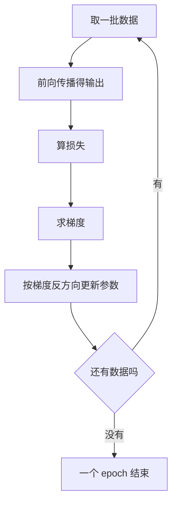

# 第 4 章：神经网络的学习

- **难度**：★★★ | **预估学时**：4 小时 | **前置**：第 3 章（前向传播）、导数与偏导

## 学习目标
学完本章，你能：写出均方误差与交叉熵两个损失函数并各算一个实例；用中心差分手算一个函数的数值导数；说明“损失 → 梯度 → 更新参数”这个循环里每一步在做什么；解释学习率过大和过小分别出什么问题。

## 一句话核心
学习就是让损失函数变小：损失衡量“现在错得多离谱”，梯度指出“参数往哪个方向改能少错一点”，学习率决定“一次改多大”。

## 零基础讲解

### 概念 1：损失函数（难度：基础）
**均方误差**：`E = 1/2 Σ (y_k - t_k)^2`，y 是网络输出，t 是正确标签。前面那个 1/2 是为了求导时把平方的 2 消掉，纯为书写方便。

**交叉熵误差**：`E = -Σ t_k log y_k`。标签用 one-hot 表示（正确答案那位是 1，其余是 0），于是这个和实际只剩一项：`E = -log(正确答案对应的输出概率)`。输出 0.9，损失是 -log0.9≈0.105；输出 0.1，损失是 -log0.1≈2.303，差了 20 多倍。

**实例**：正确类是第 3 类，网络 softmax 输出 y=(0.1, 0.05, 0.8, 0.05)，标签 t=(0,0,1,0)。交叉熵 = -log(0.8)=0.2231。若换成均方误差：1/2[(0.1)^2+(0.05)^2+(0.8-1)^2+(0.05)^2] = 1/2[0.01+0.0025+0.04+0.0025]=0.0275。两个数都不大，但交叉熵对“把正确答案判得很低”惩罚更狠。

**为什么分类用交叉熵而不用均方误差**：交叉熵配 softmax 时，对 logits 的梯度是 `y - t`，简单且不会因为 sigmoid 饱和而消失；均方误差配 softmax 会多出一个 y(1-y) 因子，输出接近 0 或 1 时梯度趋近于 0，学得很慢。

### 概念 2：数值微分与梯度（难度：进阶）
导数描述“输入动一点点，输出动多少”。数值上最稳的算法是**中心差分**：`f'(x) ≈ [f(x+h) - f(x-h)] / (2h)`，h 取 1e-4 左右。不要用前向差分 `[f(x+h)-f(x)]/h`，它的误差是 h 量级，中心差分是 h² 量级。

**梯度**是把每个变量的偏导数排成一个向量。对权重矩阵 W，梯度就是同样形状的矩阵，每个元素是损失对该元素的偏导。**梯度的方向是损失上升最快的方向，所以参数要往梯度的反方向走。**

**为什么不用数值微分做训练**：一个参数要算两次前向，一个有百万参数的网络就要算两百万次前向，慢到不可用。数值微分只用来给反向传播“验货”——第 5 章会用 `gradient_check` 对比两者。

### 概念 3：梯度下降与超参数（难度：进阶）
更新规则：`W ← W - η ∂E/∂W`，η 是学习率。

**学习率过大**：一步跨过谷底，损失来回震荡甚至越来越大；**过小**：每步挪一点点，训练慢到看不见进展。实践中先用 0.01 试，观察损失曲线：平着不动就调大，上下震荡就调小。

**mini-batch**：整个训练集太大，一次全算显存放不下，于是每次随机抽一小批（比如 100 条）算平均梯度再更新。抽完所有样本叫一个 epoch。

## 图示

看图说明：这个环每转一圈参数就变一次；梯度的正负号决定方向，学习率决定步长，损失函数的形状决定这条路好不好走。

## 类比与实例
- 类比：蒙着眼睛下山。你只能用脚感受当前这一点的坡度（梯度），然后朝最陡的下坡方向迈一步（学习率是步长）。步子太大容易跨过山谷冲到对面山坡，步子太小可能一整天下不了山。
- 实例：f(x)=x²，在 x=2 处中心差分，h=1e-4：f(2.0001)=4.00040001，f(1.9999)=3.99960001，差 0.0008，除以 2h=0.0002 得 4.0000。解析导数 2x=4，对得上。用这个例子可以校验任何数值微分实现。

## 常见误解
- 别以为训练损失降得越低越好——实际上损失降到 0 往往意味着把训练集背下来了，测试集反而变差，这叫过拟合。
- 别以为梯度是“参数该取的值”——实际上梯度是方向加斜率，参数该取多少还要乘学习率再相减。
- 别以为交叉熵和均方误差只是习惯不同——实际上在分类任务上它们的梯度性质差别很大，交叉熵配 softmax 的梯度不会饱和。

## 自测题（答案）
1. 正确类概率输出 0.1 与输出 0.9，交叉熵相差约多少倍？（答案：C；解析：-log0.1=2.303，-log0.9=0.105，约 22 倍。）
   - A. 1.5 倍　B. 9 倍　C. 22 倍　D. 相同
2. 中心差分比前向差分更准，原因是？（答案：B；解析：中心差分把一阶误差项抵消掉，误差是 h² 量级而非 h 量级。）
   - A. 计算量更大　B. 一阶误差被抵消　C. 用了两次前向　D. h 取更小
3. 训练损失持续下降但测试准确率不动，最可能是什么问题？（答案：A；解析：这是典型的过拟合，模型在记训练集的噪声。）
   - A. 过拟合　B. 学习率过小　C. 梯度消失　D. 数据太少导致必须继续训练

## 复习锚点
- 损失 = 错得多离谱；梯度 = 往哪改；学习率 = 改多大。
- 分类用交叉熵，因为配 softmax 梯度是 y-t，不会饱和。
- 中心差分误差 h²，只用于验算，不做训练。
