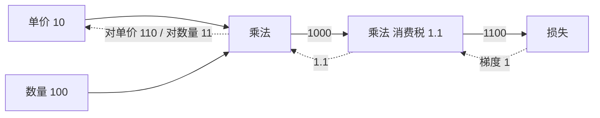

# 第 5 章：误差反向传播法

- **难度**：★★★ | **预估学时**：5 小时 | **前置**：第 4 章（梯度与链式法则）

## 学习目标
学完本章，你能：把“买苹果”这种日常计算画成计算图并手算反向传播；说出加法节点与乘法节点在反向时分别做什么；解释为什么反向传播比数值微分快几个数量级；说明梯度消失是怎么在深层 sigmoid 网络里发生的。

## 一句话核心
反向传播就是链式法则的流水线版：从最后的损失往回走，每经过一个节点，把上游传来的梯度乘以本节点的局部导数，一层层乘下去。

## 零基础讲解

### 概念 1：链式法则（难度：基础）
若 `z = f(y)`、`y = g(x)`，则 `dz/dx = (dz/dy) × (dy/dx)`。复合多少层就乘多少次，这就是全部。

**类比**：汇率换算。100 人民币换美元再换日元，最终金额对人民币的敏感度，等于“日元对美元的汇率 × 美元对人民币的汇率”。两段变化的乘积就是总变化。

### 概念 2：计算图与两个基本节点（难度：进阶）
计算图把每一步运算画成一个节点，箭头是数据流。反向传播时，从最右边传一个 1 回来（表示“损失对自己求导等于 1”），每过一个节点按规则处理：

- **加法节点**：把上游梯度原样分给两个输入。因为 `z = x + y`，`∂z/∂x = 1`，所以乘 1 就是不变。
- **乘法节点**：把上游梯度乘以“另一个输入的值”。因为 `z = x × y`，`∂z/∂x = y`，所以 x 收到的梯度是上游 × y。

**买苹果实例**：苹果单价 10 元，买 100 个，消费税 10%。
正向：10 × 100 = 1000（苹果总额），1000 × 1.1 = 1100（含税总价）。
反向：从 1100 起，传回 1。
- 过消费税节点（乘法，另一个输入 1.1）：上游 1 × 1.1 = 1.1，传回给“1000”的是 1.1。
- 过“10×100”节点（乘法）：对单价 10 的梯度 = 上游 1.1 × 100 = 110；对数量 100 的梯度 = 1.1 × 10 = 11。
含义：单价每涨 1 元，总价涨 110 元；数量每多 1 个，总价涨 11 元。这两个数就是“敏感度”，也就是梯度。

### 概念 3：为什么反向传播快（难度：进阶）
数值微分算一个参数的梯度要两次前向；反向传播一次前向加一次反向，就把**所有**参数的梯度一次算齐。参数越多，优势越大。代价是要在正向时把中间结果存下来（每个节点的输入值），内存换时间。

**实现层面**：把每个层写成一个类，正向 `forward` 返回输出并缓存输入，反向 `backward` 接收上游梯度、返回本层对输入的梯度。整网就是把各层的 backward 从后往前串起来，这叫“层实现”。

### 概念 4：梯度消失（难度：高难）
sigmoid 的导数最大只有 0.25（在 x=0 处）。五层网络反向传播，梯度最多被乘 0.25 五次，即 1/1024，前面的层几乎收不到学习信号。

**为什么 ReLU 缓解了这个问题**：ReLU 正区导数恒为 1，梯度可以原样传过多层；负区直接 0。代价是可能“死掉”一部分神经元。工程上用 He 初始化、Batch Norm 等手段把激活值控制在合理范围。

## 图示

看图说明：实线是正向数值，虚线是反向梯度。注意乘法的反向梯度会“交换”另一个输入——这是最容易记反的地方。

## 类比与实例
- 类比：一个多层审批流程。最后一步驳回，要追责到哪一层，得按每层的“放大倍数”往回折算。加法节点是“两人共同签字，责任各占一半（系数 1）”；乘法节点是“科长签字放大 3 倍”，责任就放大 3 倍传下去。
- 实例：上面苹果的例子可以直接用代码验证：把 `x=10, y=100, z=1.1` 代入 `z*x*y`，对 x 求偏导得 110，对 y 求偏导得 11，与手算一致。

## 常见误解
- 别以为反向传播是“另一个网络在反向计算”——实际上它用的还是同一套权重和同一批中间结果，只是计算顺序反过来。
- 别以为乘法节点的梯度是“上游 × 自己”——实际上乘的是**另一个输入**的值。写成“上游 × 本节点输入”必错。
- 别以为层数越深学得越好——实际上 sigmoid 叠加会让梯度指数衰减，没有残差、归一化这些手段，深层网络根本训不动。

## 自测题（答案）
1. 加法节点反向时对两个输入的梯度是？（答案：A；解析：∂(x+y)/∂x=1，上游梯度原样分发。）
   - A. 都是上游梯度本身　B. 都是 0　C. 分别是两个输入的值　D. 相加后平分
2. z = x × y，x=3、y=5，从上游传回梯度 2，则对 x 的梯度是？（答案：C；解析：∂z/∂x=y=5，乘上游 2 得 10。）
   - A. 2　B. 3　C. 10　D. 15
3. 五层纯 sigmoid 网络，梯度大约每层衰减到多少倍？（答案：B；解析：导数上界 0.25，五层最坏 0.25^5≈1/1024。）
   - A. 1/4　B. 1/1024　C. 1/5　D. 不变

## 复习锚点
- 链式法则：复合函数的导数是各段导数的乘积。
- 加法节点原样分发，乘法节点乘对方的值。
- 反向传播一次拿到全部梯度，代价是缓存中间结果。
- sigmoid 导数上界 0.25，叠深了梯度指数衰减。
