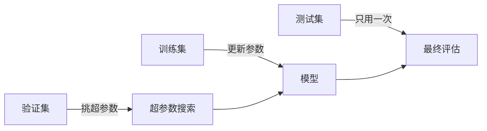

# 第 6 章：与学习相关的技巧

- **难度**：★★★ | **预估学时**：4 小时 | **前置**：第 5 章（反向传播）

## 学习目标
学完本章，你能：区分 SGD、Momentum、AdaGrad、Adam 四种更新规则各自解决了什么问题；解释权重初始值为什么会影响训练成败；说明 Batch Norm、Dropout、权值衰减分别在对付什么；给出划分训练/验证/测试集的正确做法。

## 一句话核心
训练能不能收敛，一半看梯度算得对不对，另一半看这些技巧：怎么走（优化器）、从哪出发（初始化）、走多稳（归一化）、别背题（正则化）。

## 零基础讲解

### 概念 1：四种优化器（难度：进阶）
- **SGD**：`W ← W - η ∂E/∂W`，最朴素，沿当前梯度走。缺点是在“峡谷形”损失面上来回横跳。
- **Momentum**：记住一个速度项 `v ← αv - η∂E/∂W`，`W ← W + v`。相当于给下山的小球加了惯性，方向一致的维度越走越快，来回抖的维度被平均掉。
- **AdaGrad**：给每个参数配一个“历史梯度平方和”，学习率除以它的平方根。梯度一直很大的参数步子自动变小，很少更新的参数步子相对变大。
- **Adam**：Momentum + AdaGrad，同时估一阶矩（方向）和二阶矩（尺度），再做偏置修正。工程上默认首选，但它不是万能的，有些任务上调好的 SGD 泛化更好。

**类比**：SGD 是每步都重新看路的行人；Momentum 是推着独轮车下坡，有惯性；AdaGrad 是给每个方向配了不同的刹车力度；Adam 是两者合体再加自动挡。

### 概念 2：权重初始值（难度：进阶）
不能全初始化为 0——同一层所有神经元会算出完全一样的输出、收到完全一样的梯度，永远同步，等于只有一个神经元。

**Xavier 初始化**：按前一层神经元数 n 缩放，标准差取 `1/√n`，适合 sigmoid/tanh；**He 初始化**：标准差取 `√(2/n)`，专为 ReLU 设计，因为 ReLU 把一半输出打成 0，方差少了一半，需要放大回来。

**实例对比**：一个 100→100→100 的 sigmoid 网络，若权重标准差取 0.01，各层输出会迅速塌到 0.5 附近、几乎没差别；取标准差 1，激活值又会饱和到 0 和 1。取 1/√100=0.1 时，各层输出的分布宽度才稳定。

### 概念 3：Batch Norm 与正则化（难度：高难）
**Batch Norm**：在每个 mini-batch 内，把该层输入按特征做标准化（减均值、除标准差），再乘一个可学习的 γ、加一个可学习的 β。作用是把每层输入拉回稳定分布，允许更大的学习率、对初始化不那么敏感。注意它训练时用批统计量、推理时用滑动平均，两者不一致是常见 bug 来源。

**权值衰减**：在损失里加 `λ/2 × ΣW²`，压制大权重，等价于 L2 正则。

**Dropout**：训练时随机把一部分神经元输出置 0（比如 50%），推理时全部启用并按比例缩放。作用是逼网络学冗余表示，不能依赖某几个特定神经元。

**训练/验证/测试三分**：训练集调参数，验证集挑超参数（学习率、层数、正则强度），测试集只在最后用一次。用测试集挑超参数等于提前偷看答案，报出来的准确率是虚的。

## 图示

看图说明：三条数据的用途不能混。验证集参与选择但不参与梯度更新；测试集只在最后碰一次。

## 类比与实例
- 类比：备考。训练集是课后练习，验证集是模拟考（可以反复做、用来调复习策略），测试集是期末真题（做一次就定成绩）。拿真题反复调复习策略，期末考出来的分数就不代表真实水平。
- 实例：Dropout 在训练时的实现是对输出做 `mask = (rand(n) > p)`，再 `out = out * mask / (1-p)`。这个除以 (1-p) 是“倒置 dropout”，保证训练与推理的期望一致，推理时不需要再缩放。

## 常见误解
- 别以为 Adam 一定比 SGD 好——实际上很多图像分类任务里，调好的 SGD + Momentum 泛化更好，Adam 收敛快但有时更“锐”。
- 别以为 Batch Norm 只是加速——实际上它改变了每层的输入分布，有轻微正则效果，但它和 Dropout 同时用可能互相干扰。
- 别以为权重全初始化成 0 也能学——实际上对称性没被打破，整层神经元永远一样。
- 别以为验证集准确率高就可以直接报成绩——最终数字必须来自测试集，且只评估一次。

## 自测题（答案）
1. Momentum 主要解决 SGD 的什么问题？（答案：B；解析：惯性让方向一致的维度加速、来回震荡的维度被平均，缓解峡谷形损失面上的横跳。）
   - A. 梯度消失　B. 震荡与收敛慢　C. 过拟合　D. 显存不足
2. ReLU 网络应优先用哪种初始化？（答案：C；解析：He 初始化按 √(2/n) 放大，补上 ReLU 砍掉一半方差。）
   - A. 全 0　B. Xavier　C. He　D. 固定 0.01
3. 用测试集反复挑超参数会导致？（答案：A；解析：测试集信息泄露进模型选择，报出的准确率偏乐观。）
   - A. 评估结果偏乐观　B. 训练更慢　C. 梯度消失　D. 显存溢出

## 复习锚点
- SGD 朴素、Momentum 有惯性、AdaGrad 按维调步长、Adam 两者合体。
- 初始化要打破对称，ReLU 用 He，sigmoid 用 Xavier。
- 训练调参数、验证挑超参、测试只用一次。
