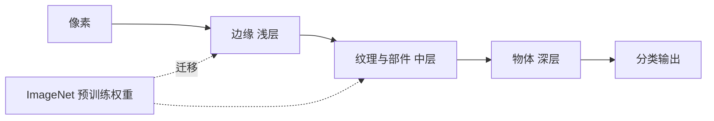

# 第 8 章：深度学习

- **难度**：★★☆ | **预估学时**：3 小时 | **前置**：第 7 章（CNN）

## 学习目标
学完本章，你能：说明“深层”到底带来了什么能力；解释迁移学习为什么能在小数据上奏效、要冻结哪部分、为什么要调小学习率；说出 GPU 与分布式训练解决的是哪一类瓶颈。

## 一句话核心
深度学习的“深”不是为了参数量，而是为了让网络逐层把像素组合成边缘、纹理、部件、物体这样的层级表示。

## 零基础讲解

### 概念 1：层级特征（难度：进阶）
浅层卷积核看到的是边缘和颜色块；中层组合成纹理和简单部件（眼睛、轮子）；深层组合成完整物体。这种“由简到繁”的分层是端到端训练自己学出来的，不是人工规定的。

**为什么不能只靠一层**：一层网络要表示“一只猫”，需要极其复杂的组合规则；拆成多层，每层只学一个简单的变换，总复杂度被分摊了。这跟用积木搭房子一个道理：不需要一块巨大的异形积木，用标准小块叠出结构。

### 概念 2：迁移学习（难度：进阶）
拿在大数据集（ImageNet，1000 类、百万张图）上训好的网络，把最后的分类层换成自己的类别，前面的卷积层直接沿用。

**两种用法**：
1. **冻结特征提取部分**，只训练新分类头——数据很少时用，几百张图也能出效果；
2. **全部微调**，但用很小的学习率（比如 1e-4 甚至 1e-5）——数据稍多时用。学习率大的话，几步就把预训练学到的通用特征冲掉了。

**为什么有效**：底层学到的边缘、纹理是几乎所有视觉任务共享的，不需要从头学。这是“知识迁移”在神经网络里的具体形式，不是比喻。

### 概念 3：为什么需要 GPU 与加速（难度：基础）
卷积的核心是大量矩阵乘法，可高度并行。CPU 几十个核心，GPU 上万个流处理器，同一批运算能并行到几千路。此外 cuDNN 这类库会针对卷积自动选算法（FFT、Winograd、im2col+GEMM）。

**分布式训练**：数据并行是每张卡放一份模型、各算一部分数据，再同步梯度。瓶颈通常在卡间通信而不是算力。

## 图示

看图说明：横向是同一张图在网络里被逐层抽象的过程；虚线表示预训练权重可以直接填到浅层与中层。

## 类比与实例
- 类比：教一个已经会开车的人开卡车。方向盘、油门、后视镜的用法是共通的（浅层特征），只需要重新学车身长度带来的转弯半径（新分类头）。从零教一个没摸过车的人，成本高得多。
- 实例：VGG16 在 ImageNet 上预训练，最后是全连接 1000 类。改成 5 类时，把最后那层换成 5 个输出、冻结前面所有卷积层，只训练新层。用几百张图、十几轮就能到不错的准确率；同样数据从零训，通常连收敛都困难。

## 常见误解
- 别以为层数越多准确率一定越高——实际上网络太深会出现退化问题，训练误差反而上升，残差连接就是为此设计的。
- 别以为微调时学习率可以照抄从头训练的值——实际上一旦学习率过大，预训练权重几步就被破坏，等于白拿。
- 别以为迁移学习只适用于图像——实际上自然语言处理里的预训练语言模型是同一套逻辑，只是“冻结”的层数和微调策略不同。

## 自测题（答案）
1. 迁移学习时数据很少，最稳妥的做法是？（答案：A；解析：冻结卷积层只训分类头，避免少量数据把通用特征破坏掉。）
   - A. 冻结卷积层只训分类头　B. 全部层用大学习率微调　C. 从零训练　D. 只改输入尺寸
2. 深层网络相对浅层网络的核心优势是？（答案：B；解析：分层表示让复杂函数被拆成多个简单变换的组合。）
   - A. 参数更少　B. 能学出层级化的特征表示　C. 不需要激活函数　D. 一定不会过拟合
3. 微调时学习率要设小的原因是？（答案：C；解析：大学习率会在几步内把预训练学到的通用特征改坏。）
   - A. 显存不够　B. 防止过拟合　C. 避免破坏预训练权重　D. 加快收敛

## 复习锚点
- “深”的价值是分层抽象，不是堆参数。
- 迁移学习：冻结 + 小学习率，两个细节都不能漏。
- GPU 加速的本质是把矩阵乘法并行化。
