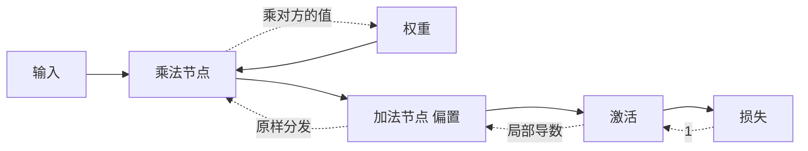

# 计算图与反向传播

- **难度**：进阶 | **涉及章节**：第 5 章

## 一句话定义
把前向计算拆成一个个节点画成图，反向时从损失出发，按链式法则把梯度一层层乘回去。

## 为什么重要
它把“求所有参数的导数”从 O(参数数 × 前向代价) 降到 O(一次前向代价)。没有它，深度学习在算力上不成立。

## 图示

## 详解
正向每经过一个节点，把输入缓存下来；反向时每个节点拿到“上游梯度”，乘以自己的局部导数，分发给自己的输入。加法节点局部导数为 1，乘法节点对某个输入的局部导数是另一个输入的值。

两个必须记住的细节：一是缓存，正向不存中间值，反向就没东西可乘；二是顺序，必须严格逆序，因为每个节点要等它的下游算完才能算。

## 常见误解
**别以为反向传播要重新跑一遍网络**——它复用正向缓存的中间结果，只做乘法和分发。

## 在书中出现的脉络
| 章节 | 语境 | 关键结论 |
|---|---|---|
| 第 4 章 | 数值微分 | 慢，只用于验算 |
| 第 5 章 | 计算图 | 一次拿到全部梯度 |
| 第 7 章 | 卷积层反向 | 池化的梯度只回传给 argmax |

## 相关概念
- 前置：链式法则、矩阵乘法
- 后续：优化器、梯度消失
