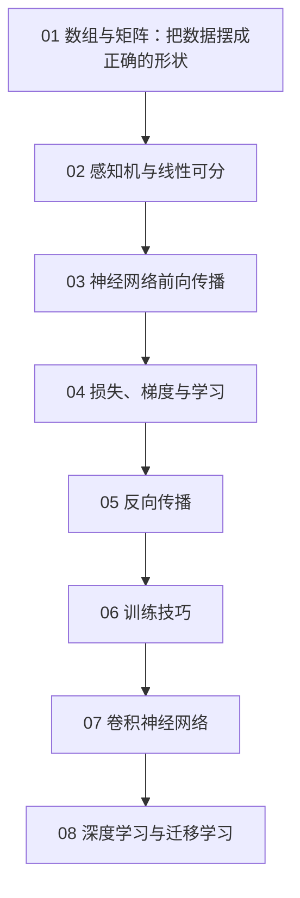

# 学习路径：深度学习入门：基于 Python 的理论与实现

## 路径总览

## 逐步展开

### 步骤 01：数组与矩阵：把数据摆成正确的形状
**阅读**：ch01
**检查点**：能手算 2×3 与 3×2 的矩阵乘法，并说明广播从哪一维开始对齐
**目标**：看到 shape 就能判断两个数组能不能运算

### 步骤 02：感知机与线性可分
**阅读**：ch02
**检查点**：能自己配出一组解异或的两层权重并逐点验算
**目标**：理解“一层只能画一条线”这个根本限制

### 步骤 03：神经网络前向传播
**阅读**：ch03
**检查点**：写出 2→3→2 网络每一层的形状变化与参数量
**目标**：能独立完成一次手算前向

### 步骤 04：损失、梯度与学习
**阅读**：ch04
**检查点**：算出一个具体样本的交叉熵，并用中心差分校验梯度
**目标**：把训练循环的每一步都说清楚

### 步骤 05：反向传播
**阅读**：ch05
**检查点**：手算苹果例子的全部反向梯度，并解释乘法节点为何乘“另一个输入”
**目标**：能自己推导任意简单计算图的梯度

### 步骤 06：训练技巧
**阅读**：ch06
**检查点**：针对“损失震荡”“泛化差”“神经元大量死亡”三种症状各给两条对策
**目标**：拿到一个训不动的网络能按顺序排查

### 步骤 07：卷积神经网络
**阅读**：ch07
**检查点**：手算三种 padding/stride 组合的输出尺寸与参数量
**目标**：理解参数共享与局部连接这两个先验

### 步骤 08：深度学习与迁移学习
**阅读**：ch08
**检查点**：为一个只有几百张图的任务写出完整的迁移学习配置
**目标**：能把预训练模型落到真实小数据集上

## 学完全程后

