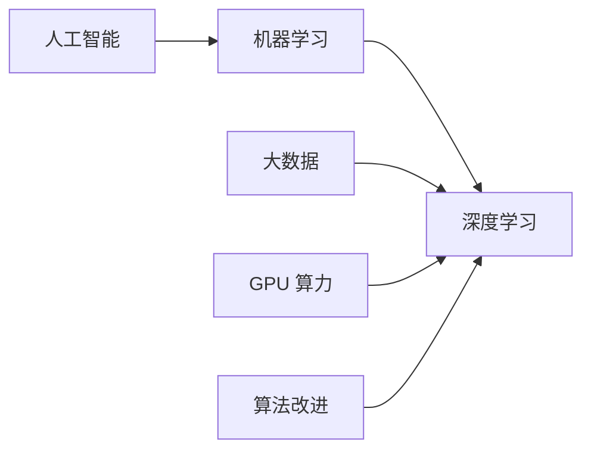

# 第 1 章：深度学习简介

- **难度**：★☆☆ | **预估学时**：2 小时 | **前置**：无

## 学习目标
学完本章，你能：说清深度学习与机器学习、人工智能三者的关系；列出深度学习在哪些任务上明显超过传统方法、为什么；解释“端到端训练”相对“手工设计特征”的优势与代价。

## 一句话核心
深度学习不是一门新算法，而是“用多层可微模块拼成一个函数，再用梯度把整条流水线一起调”的这套做法。

## 零基础讲解

### 概念 1：三者关系（难度：基础）
人工智能是最大的圈，目标是让机器完成需要智能的任务；机器学习是其中的方法子集，靠数据而不是手写规则；深度学习是机器学习里用多层神经网络的那一支。**包含关系不能反过来说**：深度学习属于机器学习，但机器学习不等于深度学习。

### 概念 2：关键转折点（难度：基础）
三件事凑齐之后深度学习才起来：**数据**（ImageNet 百万级标注）、**算力**（GPU 并行矩阵运算）、**算法**（ReLU 缓解梯度消失、Dropout 抑制过拟合、批归一化稳定训练）。少任何一样都不成立——这不是修辞，2012 年之前的网络结构与之后差别并不大，差别在数据量和算力。

### 概念 3：端到端的代价（难度：进阶）
传统流水线是人工设计特征再交给分类器；深度学习把特征也交给梯度学。好处是不用猜特征，坏处是**不可解释、不可局部修改**：模型错了你很难定位是哪一层的问题，只能靠可视化、探针、消融实验去查。

**类比**：传统方法像手工流水线，每道工序有专人负责，出问题能定位到工位；端到端像一台黑箱机器，输入原料直接出成品，效率高但坏了只能整体排查。

**类比失效的地方**：黑箱并非完全不可查，梯度、激活可视化、注意力权重都能提供线索，只是比逐工序排查贵得多。

## 图示

看图说明：左边是概念层级，右边是三个使能条件。缺一个，深度学习就停留在论文里。

## 常见误解
- 别以为深度学习什么任务都更强——实际上表格数据上梯度提升树常赢，深度网络的优势集中在图像、语音、文本这类高维有结构的数据。
- 别以为端到端就一定更好——实际上数据量不足时，人工特征 + 简单模型更稳。

## 自测题（答案）
1. 深度学习兴起的三个必要条件不包括？（答案：C；解析：数据、算力、算法是三个条件，理论完备性不是。）
   - A. 大规模数据　B. GPU 算力　C. 完备的理论保证　D. 训练算法改进
2. 端到端训练的主要代价是？（答案：B；解析：可解释性与局部可修改性变差。）
   - A. 训练变慢　B. 难定位错误来源　C. 必须用 GPU　D. 不能处理图像

## 复习锚点
- 三个圈：AI ⊃ ML ⊃ DL。
- 三条件：数据、算力、算法。
- 端到端换来性能，付出可解释性。
