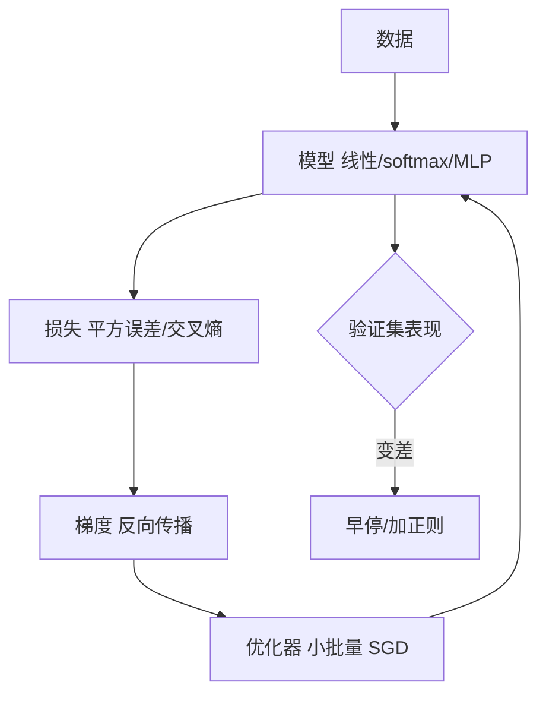

# 第 3 章：深度学习基础

- **难度**：★★★ | **预估学时**：6 小时 | **前置**：第 1、2 章

## 学习目标
学完本章，你能：写出线性回归与 softmax 回归的损失、梯度和更新式；解释多层感知机为什么必须加非线性激活；说清权重衰减与 Dropout 各自的作用机制；判断训练中出现 NaN 时最可能是哪个环节的问题。

## 一句话核心
本章把“模型—损失—优化”这条主线在三个由浅到深的模型上各走一遍：线性回归、softmax 回归、多层感知机，再加上让训练稳定的几个技巧。

## 零基础讲解

### 概念 1：线性回归（难度：基础）
模型 `ŷ = wᵀx + b`，损失用平方误差 `ℓ = (ŷ-y)²/2`，整个训练集上取平均。小批量随机梯度下降：每次抽 B 个样本，`w ← w - η (1/B) Σ ∂ℓ/∂w`。

**闭式解与梯度下降的关系**：线性回归有闭式解 `w=(XᵀX)^{-1}Xᵀy`，但特征维度高时矩阵求逆代价太大，所以实践中仍用梯度下降。这是“有解析解也未必用它”的典型例子。

### 概念 2：softmax 回归（难度：进阶）
多分类时输出每个类的分数 o_j，`ŷ_j = exp(o_j)/Σ_k exp(o_k)`，损失用交叉熵 `ℓ = -Σ y_j log ŷ_j`（y 是 one-hot）。

**梯度为什么这么干净**：对 o_j 求导得 `ŷ_j - y_j`。这个结果值得记牢：预测减标签，没有额外的饱和因子。这就是第 5 章能写出漂亮反向公式的原因。

**数值稳定性**：`exp` 遇到大数会溢出。做法是先减去最大值 `o_j - max(o)`，softmax 结果不变但不会溢出。这个技巧在几乎所有实现里都有。

### 概念 3：多层感知机（难度：进阶）
`H = σ(XW₁+b₁)`，`O = HW₂+b₂`。如果没有 σ，`O = XW₁W₂ + ...` 仍是线性，等价于单层。**激活函数的存在是为了让“深”有意义。**

**通用近似**：单隐层、足够多神经元可以逼近任意连续函数，但所需神经元可能指数级多；深层用少得多的参数达到同样表达力。

### 概念 4：过拟合与正则（难度：进阶）
- **权重衰减**：损失加 `λ/2 ||w||²`，梯度里多出 `λw`，每次更新都把 w 往 0 拉一点。
- **Dropout**：训练时按概率 p 把隐藏层输出置 0，再做 `/(1-p)` 缩放保持期望；推理时全部启用、不缩放。
- **早停**：验证误差开始上升就停。

**实例**：三层网络在 100 个样本上训练，训练损失降到 0.01 而验证损失升到 2.0，这是典型过拟合。加 λ=0.1 的权重衰减后训练损失升到 0.3、验证损失降到 0.8，泛化变好。

### 概念 5：数值稳定性与初始化（难度：高难）
反向传播是连乘，激活值或梯度稍偏离 1，几十层后就会爆炸或消失。对策：合理的初始化（Xavier/He）、批归一化、梯度裁剪、用 ReLU 类激活。

**梯度裁剪**：当梯度范数超过阈值 θ 时按比例缩放，`g ← g × θ/||g||`。它是 RNN 训练的标配，因为序列长时梯度极易爆炸。

## 图示

看图说明：左边是训练闭环，右下角是监控出口。训练不是一直跑，要盯着验证集决定何时停。

## 常见误解
- 别以为 softmax 回归是“回归”——实际上它是分类模型，只是借用了回归的线性打分形式。
- 别以为 Dropout 只在训练时随机就够——实际上推理时的缩放必须配套，否则输出尺度不一致。
- 别以为损失变成 NaN 一定是学习率太大——实际上也可能是 exp 溢出、除零、log(0)，要按顺序查。

## 自测题（答案）
1. softmax 对分数的梯度是？（答案：B；解析：∂ℓ/∂o_j = ŷ_j - y_j。）
   - A. ŷ_j　B. ŷ_j - y_j　C. y_j - ŷ_j　D. 1
2. MLP 去掉激活函数会怎样？（答案：C；解析：多层线性变换等价于单层线性变换。）
   - A. 变成 SVM　B. 训练更快　C. 退化为线性模型　D. 不影响结果
3. 权重衰减在梯度上表现为？（答案：A；解析：损失加 λ/2||w||² 后梯度多出 λw 项。）
   - A. 每次更新多减 λw　B. 学习率变小　C. 梯度被裁剪　D. 参数被置零

## 复习锚点
- 线性回归：平方损失 + 小批量 SGD。
- softmax + 交叉熵，梯度是预测减标签。
- 没有非线性，深层等于单层。
- 正则三件套：权重衰减、Dropout、早停。
