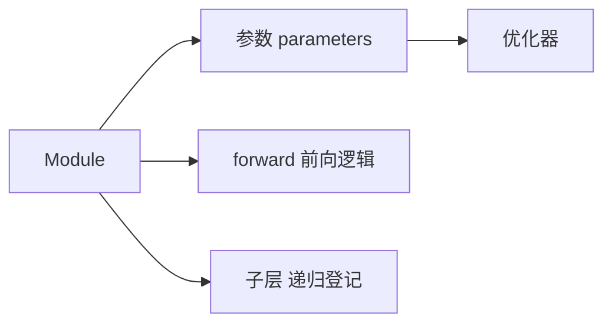

# 第 4 章：深度学习计算

- **难度**：★★☆ | **预估学时**：3 小时 | **前置**：第 3 章

## 学习目标
学完本章，你能：用 Module 类组织一个模型并管理其参数；区分“参数”与“超参数”；把模型保存到文件再读回来；说明数据放到 GPU 上之后哪些操作会自动跟随、哪些必须手动。

## 一句话核心
模型是一个“装着参数的容器”，训练脚本只跟容器打交道；容器把参数、前向逻辑、初始化规则封装在一起。

## 零基础讲解

### 概念 1：Module 与层（难度：基础）
`nn.Module` 的子类在 `__init__` 里声明子层，在 `forward` 里定义数据怎么流。框架通过 `__setattr__` 自动把子层登记到参数表里，所以不需要手动维护参数列表。

**为什么要封装**：一个模型可能有几十层，手动管理每个参数的名字、形状、初始化方式几乎不可能不出错。封装之后 `net.parameters()` 一次拿到全部。

### 概念 2：参数管理（难度：进阶）
`net.parameters()` 返回所有参数，`net.named_parameters()` 带名字。初始化用 `net.apply(init_fn)` 遍历每个子模块。

**参数与超参数的区别**：参数是梯度能改的（权重、偏置、BN 的 γ/β）；超参数是训练前定的（学习率、层数、正则强度）。后者只能靠验证集搜。

### 概念 3：自定义层（难度：进阶）
无参数的层（如自己实现一个中心化层）直接写 `forward`；有参数的层要在 `__init__` 里 `self.params = [self.w, self.b]` 登记，否则优化器拿不到它们。

### 概念 4：读写与 GPU（难度：进阶）
保存用 `np.save` 或框架的 `save`，读回时**必须先建同结构模型再 load**。GPU 上要注意：`net.to(device)` 只搬参数，数据必须自己 `.to(device)`；运算要求两边在同一设备上，否则报错。

**实例**：`X` 在 CPU、`W` 在 GPU，做 `X @ W` 直接报错。常见写法是 `X = X.to(device)` 之后再前向。

## 图示

看图说明：优化器只认参数，不认模块结构。所以自定义层如果忘了登记参数，训练时它永远不更新，也不会报错——这是最隐蔽的一类 bug。

## 常见误解
- 别以为把模型 `.to(device)` 之后数据会自动跟过去——实际上数据要手动搬。
- 别以为自定义层里的张量会自动成为参数——实际上必须显式加入参数列表，否则不会被优化。
- 别以为保存模型等于保存代码——实际上只存参数，读回要靠同样的类定义。

## 自测题（答案）
1. 自定义层里忘了登记参数会怎样？（答案：C；解析：优化器拿不到该参数，它永远保持初值，且不报错。）
   - A. 报错　B. 自动登记　C. 该参数不更新　D. 模型无法前向
2. 模型搬到 GPU 后数据要？（答案：B；解析：参数在哪个设备，数据就必须显式搬过去。）
   - A. 自动跟随　B. 手动搬　C. 无需搬　D. 只能留 CPU

## 复习锚点
- Module = 参数的容器 + 前向逻辑。
- 参数靠梯度改，超参数靠验证集选。
- 自定义层要显式登记参数；GPU 上数据要手动搬。
