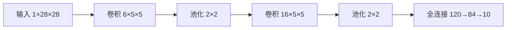

# 第 5 章：卷积神经网络

- **难度**：★★★ | **预估学时**：5 小时 | **前置**：第 3、4 章

## 学习目标
学完本章，你能：写出卷积层输出尺寸公式并手算多通道情形；解释 1×1 卷积为什么能改变通道数；说明池化层在反向时如何传梯度；画出 LeNet 的结构并算出它的参数量。

## 一句话核心
卷积层用“局部连接 + 权重共享”替换全连接，把图像的空间结构写进网络结构里。

## 零基础讲解

### 概念 1：互相关与卷积（难度：进阶）
深度学习里说的“卷积”实际是互相关：核不翻转，直接逐元素乘加。二维互相关的输出 `Y[i,j] = ΣΣ X[i+a, j+b] W[a,b]`。

**多通道**：输入 3 通道、输出 2 通道时，核的形状是 `(输出通道, 输入通道, 核高, 核宽)`，即 `(2,3,3,3)`。每个输出通道由全部输入通道加权求和得到——不是每个输入通道配一个输出通道。

**1×1 卷积**：核大小为 1，看起来什么也没做，但它对每个位置做跨通道的线性组合，可以把 256 通道压到 64 通道，参数量只有 256×64。它等价于在通道维度上做全连接，常用于降维和增加非线性。

### 概念 2：填充与步幅（难度：基础）
输出尺寸 `(H-K+2P)/S + 1`。常见组合：K=3、P=1、S=1 保持尺寸；K=3、P=1、S=2 尺寸减半；K=5、P=2、S=1 保持尺寸。

**为什么常用奇数核**：奇数核有中心点，填充对称时输出尺寸容易保持一致，实现上更整齐。

### 概念 3：池化（难度：进阶）
`K=2、S=2` 的最大池化把每个 2×2 区域压成一个数，尺寸减半。它没有参数。反向时梯度只回传给正向取到最大值的那个位置，其余位置为 0——所以实现里必须记住 argmax。

### 概念 4：LeNet（难度：进阶）
结构：卷积(1→6, 5×5) → 池化 → 卷积(6→16, 5×5) → 池化 → 全连接 120 → 84 → 10。

**参数量算一遍**：第一层 6×1×5×5+6=156；第二层 16×6×5×5+16=2416；全连接 16×5×5=400 到 120 是 400×120+120=48120。总约 6 万。相比同样输入尺寸的全连接网络（28×28 直接连 120 个神经元就要 9 万多参数一层），卷积省了一个数量级。

## 图示

看图说明：注意空间尺寸逐层缩小、通道数逐层增加。这是 CNN 的通用节奏：越深，感受野越大、语义越抽象。

## 常见误解
- 别以为卷积核必须翻转才是卷积——实际上深度学习框架默认做互相关，不翻转，公式与实现一致更方便。
- 别以为 1×1 卷积是“无用的卷积”——实际上它是通道维的全连接，是现代网络降维的核心组件。
- 别以为池化只是为了省算力——实际上它扩大了后续层的感受野，并提供一定的平移不变性。

## 自测题（答案）
1. 输入 32×32、核 5×5、P=2、S=1，输出尺寸？（答案：C；解析：(32-5+4)/1+1=32。）
   - A. 28　B. 30　C. 32　D. 34
2. 输入 3 通道输出 64 通道、核 3×3 的卷积层参数量？（答案：B；解析：3×3×3×64+64=1792。）
   - A. 576　B. 1792　C. 2304　D. 1728

## 复习锚点
- 输出尺寸 = (H-K+2P)/S+1。
- 多通道卷积核形状是 (出, 入, 高, 宽)。
- 1×1 卷积 = 通道维全连接。
- 池化无参数，反向只传 argmax。
