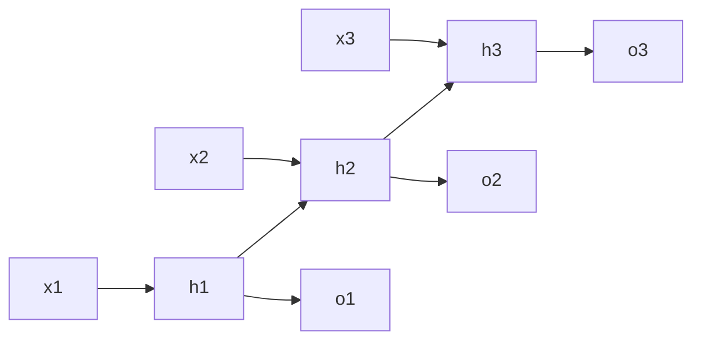

# 第 6 章：循环神经网络

- **难度**：★★★ | **预估学时**：6 小时 | **前置**：第 3、5 章

## 学习目标
学完本章，你能：写出 RNN 的隐状态更新式并说明参数共享的含义；解释通过时间反向传播为什么会梯度爆炸/消失；对比 GRU 与 LSTM 的门控结构；说清双向 RNN 与深层 RNN 各自的适用场景。

## 一句话核心
RNN 把“上一步的隐状态”当作额外输入，让网络有了记忆；代价是反向传播要沿时间连乘，梯度极易失控。

## 零基础讲解

### 概念 1：序列模型与 RNN（难度：进阶）
`h_t = φ(W_hh h_{t-1} + W_xh x_t + b_h)`，`o_t = W_ho h_t + b_o`。

**参数共享**：所有时间步用同一组 W 和 b。这带来两个后果：一是参数量与序列长度无关，二是同一个模式出现在不同位置都能被识别。

**隐状态的含义**：它是“到目前为止看过的东西的压缩摘要”。注意它是个固定维度的向量，序列再长也只能塞进这么多信息——这是 RNN 长程记忆差的根本原因。

### 概念 2：通过时间反向传播 BPTT（难度：高难）
把展开后的 T 个时间步当成 T 层网络做反向传播。梯度里会出现 `∏ ∂h_t/∂h_{t-1}`，每个因子含 `W_hh` 与激活导数。若它们范数小于 1，连乘后指数衰减（梯度消失）；大于 1 则指数增长（梯度爆炸）。

**对策**：梯度裁剪（爆炸）、门控结构（消失）、截断 BPTT（限制回传步数）。

### 概念 3：GRU 与 LSTM（难度：高难）
**GRU**：重置门 `r_t` 控制“忽略多少过去”，更新门 `z_t` 控制“保留多少过去”。`h_t = z_t ⊙ h_{t-1} + (1-z_t) ⊙ h̃_t`。

**LSTM**：三个门（输入、遗忘、输出）加一个细胞状态 `c_t`。关键在细胞状态的更新是**加法**：`c_t = f_t ⊙ c_{t-1} + i_t ⊙ c̃_t`。加法让梯度可以近乎原样地沿时间传回去，这是 LSTM 缓解梯度消失的核心机制，不是靠“门更复杂”。

**类比**：GRU 像一个人做笔记，决定哪些旧内容擦掉、哪些新内容写上；LSTM 像一条传送带（细胞状态），上面只做小幅增删，所以东西能一直传很远。

**类比失效的地方**：LSTM 也会遗忘，只是遗忘由学出来的门控制，不是完全不丢。

### 概念 4：双向与深层（难度：进阶）
**双向 RNN**：正向和反向各跑一个 RNN，拼起来。适合“整句已知”的任务（分类、标注），不适合在线预测（未来还没来）。

**深层 RNN**：在时间维之外再堆层，第 l 层的输出作为第 l+1 层的输入。层数增加会放大梯度问题，通常配残差连接。

## 图示

看图说明：横向是时间展开，纵向是同一组参数在不同时刻复用。反向传播要沿着这条横向链一路乘回去。

## 常见误解
- 别以为 RNN 能记住任意长的历史——实际上隐状态维度固定，长程信息会被覆盖。
- 别以为 LSTM 解决了梯度消失——实际上它只是让梯度更容易保留，极长序列上仍会衰减。
- 别以为双向 RNN 总比单向好——实际上需要实时输出的任务不能用双向，因为它偷看了未来。

## 自测题（答案）
1. RNN 参数共享的含义是？（答案：B；解析：所有时间步共用同一组权重。）
   - A. 不同时间步不同权重　B. 所有时间步共用一组权重　C. 只共享偏置　D. 每层共享
2. LSTM 缓解梯度消失的关键设计是？（答案：C；解析：细胞状态采用加法更新，梯度可近似原样回传。）
   - A. 更多参数　B. 三个门　C. 细胞状态的加法更新　D. 双向结构
3. 双向 RNN 不适合哪类任务？（答案：A；解析：需要实时逐词输出时未来信息不可得。）
   - A. 实时流式预测　B. 整句情感分类　C. 命名实体标注　D. 离线文本分类

## 复习锚点
- RNN：隐状态携带历史，参数在时间上共享。
- BPTT 连乘导致梯度爆炸/消失，对策是裁剪与门控。
- LSTM 的核心是细胞状态的加法路径。
- 双向要未来信息，实时任务不能用。
