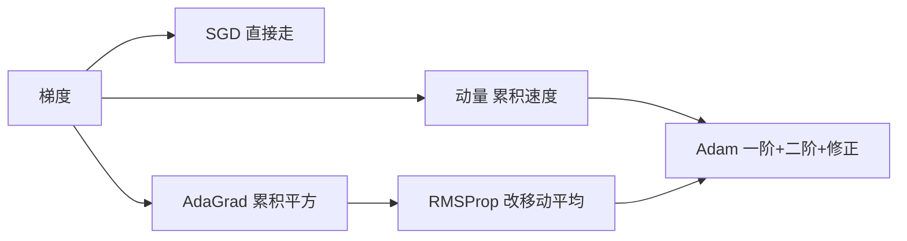

# 第 7 章：优化算法

- **难度**：★★★ | **预估学时**：5 小时 | **前置**：第 3 章、凸优化基础

## 学习目标
学完本章，你能：区分优化目标与泛化目标为什么不是一回事；手推动量与 Adam 的更新式；说明 AdaGrad 的学习率为什么单调递减、RMSProp 如何修正；列出学习率调度的三种常用策略。

## 一句话核心
优化算法解决的是“怎么在非凸、有噪声、参数尺度差异大的曲面上走得稳”，而不是“怎么找到全局最优”。

## 零基础讲解

### 概念 1：优化与泛化的分离（难度：进阶）
训练损失最小不等于泛化最好。原因有三：经验风险只是真实风险的近似；模型容量过大会记住噪声；非凸问题的局部极小可能恰好泛化不错，追求全局最小反而过拟合。

**实践含义**：不要死磕训练损失，要盯验证集。

### 概念 2：动量法（难度：进阶）
`v_t = β v_{t-1} + (1-β) g_t`（有的写法不带 1-β），`θ ← θ - η v_t`。

**为什么有效**：在梯度方向一致的维度上，速度累积使步长变大；在来回震荡的维度上，正负抵消使步长变小。效果等价于“按维度自适应调整步长”。

**实例**：β=0.9 时，连续 10 步梯度都是 1，速度趋于 10 而不是 1，相当于学习率放大 10 倍。这也是动量需要配更小学习率的原因。

### 概念 3：自适应学习率（难度：高难）
- **AdaGrad**：`s_t = s_{t-1} + g_t²`，`θ ← θ - η g_t/√(s_t+ε)`。梯度一直大的维度分母大、步长自动变小。缺点是 s 单调累加，后期学习率趋近 0，训练提前停滞。
- **RMSProp**：把累加改成指数移动平均 `s_t = γ s_{t-1} + (1-γ) g_t²`，解决 AdaGrad 停滞的问题。
- **Adam**：同时估一阶矩 m（动量）和二阶矩 v（尺度），并做偏置修正 `m̂ = m/(1-β₁ᵗ)`、`v̂ = v/(1-β₂ᵗ)`，最后 `θ ← θ - η m̂/(√v̂+ε)`。

**偏置修正为什么必要**：m 和 v 初值为 0，前几步会系统性偏小；除以 (1-βᵗ) 正好把它拉回无偏估计。不修正的话，训练初期步长会异常小。

### 概念 4：学习率调度（难度：进阶）
- **分段常数**：每隔若干 epoch 降一半。
- **余弦退火**：沿余弦曲线从 η_max 降到 η_min，后期精细收敛。
- **预热**：前若干步从很小的学习率线性升到目标值，避免初期梯度爆炸（Transformer 训练标配）。

## 图示

看图说明：从 SGD 到 Adam 是一条不断加机制的路：先加惯性，再加按维缩放，最后合体并修正偏差。

## 常见误解
- 别以为 Adam 不需要调学习率——实际上默认 1e-3 只是起点，很多任务要调到 1e-4。
- 别以为 AdaGrad 一定比 SGD 好——实际上它在长训练中会停滞，稀疏数据上才明显占优。
- 别以为动量越大越好——实际上 β 太大时速度会overshoot，来回振荡。

## 自测题（答案）
1. Adam 的偏置修正解决什么问题？（答案：B；解析：一二阶矩初值为 0 导致前几步估计偏小。）
   - A. 梯度爆炸　B. 初期估计偏小　C. 学习率衰减　D. 内存占用
2. AdaGrad 的主要缺陷是？（答案：C；解析：平方累加单调增长，学习率趋近 0，训练停滞。）
   - A. 需要更多内存　B. 不能处理稀疏数据　C. 后期学习率趋零　D. 无法并行
3. 动量法在震荡维度上的效果是？（答案：A；解析：正负梯度相互抵消，步长变小。）
   - A. 步长变小　B. 步长变大　C. 不变　D. 变成 0

## 复习锚点
- 优化目标 ≠ 泛化目标，盯验证集。
- 动量 = 按维度自适应的步长；Adam = 动量 + 二阶矩 + 偏置修正。
- AdaGrad 会停滞，RMSProp 用移动平均修正。
- 预热 + 余弦退火是现代训练的常用组合。
