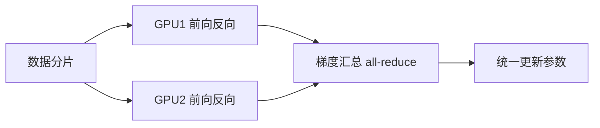

# 第 8 章：计算性能

- **难度**：★★☆ | **预估学时**：3 小时 | **前置**：第 4、7 章

## 学习目标
学完本章，你能：说清异步计算为什么能提速、代价是什么；解释数据并行与模型并行的分工；判断一个训练瓶颈在算力、显存还是通信。

## 一句话核心
深度学习训练的性能问题，九成是“GPU 等 CPU”或“卡等卡”，很少是真的算不过来。

## 零基础讲解

### 概念 1：异步计算（难度：进阶）
Python 发出指令后不等 GPU 算完就返回，靠队列排队。好处是 CPU 与 GPU 能重叠工作；代价是调试困难——报错位置和真正出错的位置可能差很远，而且必须显式同步（如 `.wait_to_read()`）才能测时间。

**实例**：连续发 1000 个矩阵乘法，Python 侧几乎瞬间返回，实际执行时间要在最后同步时才能测到。

### 概念 2：自动并行与计算图（难度：进阶）
框架会把计算图里没有依赖的节点并行调度。所以写法上要尽量让独立计算并列，而不是串成一长条。

### 概念 3：多 GPU 训练（难度：高难）
- **数据并行**：每张卡放完整模型，各算一部分数据，梯度汇总后统一更新。最常用。
- **模型并行**：一个大模型切成几块分放不同卡，中间结果要跨卡传输。用于单卡放不下的大模型。
- **参数服务器**：把参数集中存放，worker 拉取、计算、推送梯度。适合超大规模集群。

**瓶颈判断**：单卡训练时 GPU 利用率低 → 查数据加载（IO 瓶颈）；多卡扩展比差 → 查通信带宽；显存 OOM → 查批大小与模型并行。

## 图示

看图说明：数据并行的关键是最后那一步通信。卡越多，通信占比越高，扩展比越差。

## 常见误解
- 别以为卡越多越快——实际上通信开销会吃掉收益，超过一定规模后加速比趋平。
- 别以为异步计算总是好事——实际上它让计时和调试都变难，必须显式同步。
- 别以为 OOM 只能减小 batch——实际上也可以用梯度累积、混合精度、重计算来省显存。

## 自测题（答案）
1. 数据并行中每张卡存放？（答案：B；解析：每卡一份完整模型，数据分片。）
   - A. 模型的一部分　B. 完整模型　C. 只有参数　D. 只有数据
2. 单卡 GPU 利用率低最可能的原因？（答案：A；解析：数据加载跟不上，GPU 在等 CPU。）
   - A. 数据加载瓶颈　B. 算力不足　C. 显存不足　D. 通信瓶颈

## 复习锚点
- 异步计算：CPU 与 GPU 重叠，但调试与计时都变难。
- 数据并行分数据、模型并行分模型。
- 先判断瓶颈在 IO、算力、显存还是通信，再选手段。
